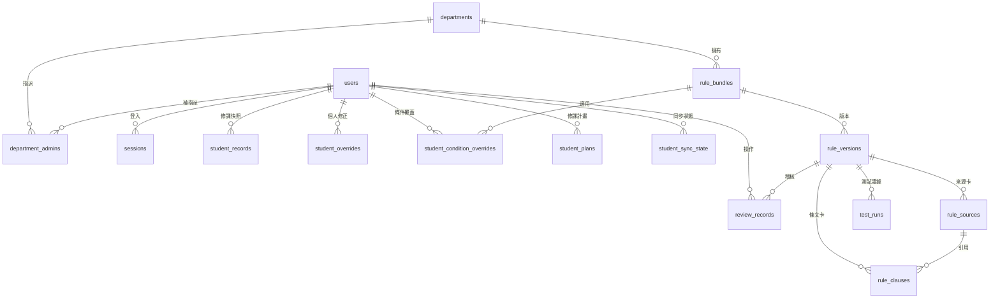

# 資料庫設計（PostgreSQL）

Extends: system-design.md §9（資料模型的概覽版）

NTOUER Academic Planner｜Iteration 2｜2026/11/16

本文件是**欄位級細節的唯一真相**：型別、`NOT NULL`、主鍵與外鍵、索引與其存在的理由、遷移順序、seed、快取與保留政策。`system-design.md` §9 只保留「有哪幾張表、各自負責什麼」的概覽並連回本文件；兩邊衝突時以本文件為準，並回頭修 §9。

前置決策見 [ADR-0001](adr/0001-rules-as-data-immutable-versions.md)（規則即資料、版本不可變）、[ADR-0002](adr/0002-postgresql-jsonb.md)（PostgreSQL ＋ jsonb）、[ADR-0003](adr/0003-google-oidc-identity.md)（Google OIDC、後端工作階段）、[ADR-0004](adr/0004-migration-tooling.md)（migration 工具與順序）。

---

## 1. 命名與型別慣例

| 項目 | 慣例 | 理由 |
| --- | --- | --- |
| 表名／欄位名 | `snake_case`、複數表名 | 與 SQL 一致，避免引號大小寫問題 |
| 時間 | 一律 `timestamptz`，只存 UTC | 伺服器與使用者時區不同；顯示時才轉 Asia/Taipei |
| 學分 | `numeric(4,1)` 且 `>= 0` | 目前規則皆整數學分，但保留 0.5 學分的空間（見 §12 待確認 2） |
| 主鍵 | 業務識別碼用 `text`，其餘用 `uuid` | `cse-113-day@3` 這種版本號要能直接出現在 API 與稽核紀錄裡；使用者不需要人類可讀的 id |
| 規則內容 | `jsonb`，不拆成節點表 | ADR-0001：`payload` 是真相，`rule_sources`／`rule_clauses` 是投影 |
| 布林 | `boolean NOT NULL DEFAULT …`，不用 `char(1)` | 不需要三態；三態屬引擎輸出（`met`／`notMet`／`unknown`），不進資料表 |
| 列舉 | `text` ＋ `CHECK (… IN (…))`，不用 PG `ENUM` | 加值只要改 CHECK，不必 `ALTER TYPE`；遷移成本低 |
| 刪除 | 業務資料不做硬刪除（`revoked_at`、`superseded`）；只有學生本人資料可刪 | FR-18「已發布版本與稽核紀錄不得被刪除或改寫」 |

`gen_random_uuid()` 在 PostgreSQL 13 以後內建，**不需要** `pgcrypto` 擴充，因此沒有 `CREATE EXTENSION` 的遷移。

## 2. ER 圖

三個刻意的設計：

- **`rule_versions` 是版本的根**：`rule_sources`、`rule_clauses`、`review_records`、`test_runs` 都掛在版本上，所以「刪掉一個版本」在資料層就等於刪掉它的全部證據——因此版本本身不可刪（§6）。
- **`student_condition_overrides` 掛在 `bundle_id` 而不是 `version_id`**：個人覆蓋要跨版本延續（TC-20），換版時才判斷哪些覆蓋還能沿用（system-design.md §5.3）。
- **`sessions` 獨立一張表**：ADR-0003 要求登出能即時撤銷，簽章式 cookie 做不到「立刻失效」，所以工作階段必須落在資料庫。

## 3. 欄位定義

以下每張表先列欄位，再列約束與索引並說明理由。`pk`＝主鍵、`fk`＝外鍵、`uq`＝唯一。

### 3.1 `departments`（系所）

| 欄位 | 型別 | NULL | 預設 | 說明 |
| --- | --- | --- | --- | --- |
| `dept_id` | `text` | 否 | — | pk。穩定 slug，如 `cse`、`mmd`；出現在 `bundleId`，**不可改名** |
| `name` | `text` | 否 | — | 顯示名稱，如「資訊工程學系」 |
| `college` | `text` | 是 | — | 所屬學院；未確認時留空，不猜 |
| `active` | `boolean` | 否 | `true` | 停用系所保留歷史規則，不刪資料 |
| `created_at` | `timestamptz` | 否 | `now()` | — |

- `uq (name)`：系所名稱不重複，避免同一系所被建兩份。
- 理由：`dept_id` 一旦進入 `bundle_id`（如 `cse-113-day`）就成為對外識別碼，事後改名會使歷史版本與 Issue 對不上，所以設計成「只能停用、不能改名」。

### 3.2 `users`（使用者）

| 欄位 | 型別 | NULL | 預設 | 說明 |
| --- | --- | --- | --- | --- |
| `user_id` | `uuid` | 否 | `gen_random_uuid()` | pk |
| `google_sub` | `text` | 否 | — | uq。Google OIDC 的 `sub`，**唯一身分鍵**（ADR-0003） |
| `email` | `text` | 否 | — | 顯示與聯絡用；可變，不作識別 |
| `role` | `text` | 否 | `'student'` | `student`／`sysadmin`；系所管理員由 `department_admins` 決定，**不放在這裡** |
| `created_at` | `timestamptz` | 否 | `now()` | — |
| `last_login_at` | `timestamptz` | 是 | — | 最近成功登入時間 |

- `pk (user_id)`、`uq (google_sub)`、`check (role in ('student','sysadmin'))`。
- 理由：`role` 只放「系統級」角色。系所管理員是「相對於某個系所」的關係，放進 `users.role` 會無法表達一人管兩系、或撤銷單一系所。

### 3.3 `sessions`（登入工作階段）

| 欄位 | 型別 | NULL | 預設 | 說明 |
| --- | --- | --- | --- | --- |
| `token_hash` | `text` | 否 | — | pk。cookie 內容的 SHA-256；**不存原始 token** |
| `user_id` | `uuid` | 否 | — | fk → `users`，`on delete cascade` |
| `created_at` | `timestamptz` | 否 | `now()` | — |
| `expires_at` | `timestamptz` | 否 | — | 到期即失效（建議 7 天） |
| `revoked_at` | `timestamptz` | 是 | — | 登出或管理者強制撤銷 |
| `user_agent` | `text` | 是 | — | 稽核與排查用，可為空 |

- `idx (user_id) where revoked_at is null`：登出全部裝置、列出有效工作階段。
- `idx (expires_at)`：清理過期資料。
- 理由：資料庫洩漏時，`token_hash` 無法還原成可用 cookie；撤銷只要寫一欄，NFR-04 的「登出後不得繼續存取」才有機制。

### 3.4 `department_admins`（系所管理員指派）

| 欄位 | 型別 | NULL | 預設 | 說明 |
| --- | --- | --- | --- | --- |
| `dept_id` | `text` | 否 | — | pk 之一。fk → `departments` |
| `user_id` | `uuid` | 否 | — | pk 之一。fk → `users` |
| `granted_by` | `uuid` | 否 | — | fk → `users`（系統管理員） |
| `granted_at` | `timestamptz` | 否 | `now()` | — |
| `revoked_at` | `timestamptz` | 是 | — | 非 null 表示已撤銷；**不刪除列** |
| `revoked_by` | `uuid` | 是 | — | fk → `users` |

- `pk (dept_id, user_id)`：一系一人只有一列。若要撤銷後再指派，把 `revoked_at` 清回 null 並更新 `granted_*`，保留同一列的歷史。
- `idx (user_id) where revoked_at is null`：每次請求驗權限時的查詢（「這個人可以管哪些系所」）。
- `idx (dept_id) where revoked_at is null`：UI-11 列出各系的現任管理員。
- 理由：FR-13 要求「撤銷最後一位後恢復由系統管理員發布」，而「最後一位」是查詢結果而不是旗標，所以用「有效列的數量」表達，不另外維護 `has_admin` 欄位（會有兩份真相）。

### 3.5 `rule_bundles`（規則包身分）

| 欄位 | 型別 | NULL | 預設 | 說明 |
| --- | --- | --- | --- | --- |
| `bundle_id` | `text` | 否 | — | pk。`{dept}-{entry_year}-{program}`，如 `cse-113-day` |
| `dept_id` | `text` | 否 | — | fk → `departments` |
| `entry_year` | `smallint` | 否 | — | 入學年度（民國），如 `113` |
| `program` | `text` | 否 | — | 學制，如 `day`（日間學士班） |
| `title` | `text` | 否 | — | 顯示名稱，如「資工 113 日間學士班」 |
| `created_at` | `timestamptz` | 否 | `now()` | — |

- `pk (bundle_id)`、`uq (dept_id, entry_year, program)`、`check (entry_year between 100 and 130)`。
- `idx (dept_id, entry_year)`：`GET /api/rules?dept=cse&year=113` 走這條。
- 理由：`bundle_id` 由三個維度組合而來，用唯一約束保證「一個系所×年度×學制只有一個規則包」，不靠應用層檢查。

### 3.6 `rule_versions`（版本與內容）

| 欄位 | 型別 | NULL | 預設 | 說明 |
| --- | --- | --- | --- | --- |
| `version_id` | `text` | 否 | — | pk。`{bundle_id}@{version_no}`，如 `cse-113-day@3` |
| `bundle_id` | `text` | 否 | — | fk → `rule_bundles` |
| `version_no` | `integer` | 否 | — | 從 1 起算，同 bundle 內遞增 |
| `status` | `text` | 否 | `'draft'` | `draft`／`validating`／`testing`／`in-review`／`approved`／`published`／`superseded` |
| `payload` | `jsonb` | 否 | — | 整份規則包（ADR-0001） |
| `schema_version` | `text` | 否 | — | 對應 `rule-bundle.schema.json` 的版本，讀取時才知道用哪版驗證 |
| `content_hash` | `text` | 否 | — | `payload` 的 SHA-256；發布後不得變 |
| `created_by` | `uuid` | 否 | — | fk → `users` |
| `created_at` | `timestamptz` | 否 | `now()` | — |
| `submitted_at` | `timestamptz` | 是 | — | 送審時間 |
| `reviewed_by` | `uuid` | 是 | — | fk → `users`；核准／退回的人 |
| `reviewed_at` | `timestamptz` | 是 | — | — |
| `published_by` | `uuid` | 是 | — | fk → `users` |
| `published_at` | `timestamptz` | 是 | — | — |
| `proxy` | `boolean` | 否 | `false` | 系統管理員代理發布時為 true（FR-12 的「未經系所審核」標示） |
| `superseded_at` | `timestamptz` | 是 | — | 被新版本取代的時間 |
| `notes` | `text` | 是 | — | 退回原因或說明 |

- `pk (version_id)`、`uq (bundle_id, version_no)`、`check (status in (…))`。
- `partial idx (bundle_id, version_no desc) where status = 'published'`：取「某規則包最新已發布版本」是學生端每一次檢核的前置查詢，用部分索引只掃已發布列。
- `idx (status)`：管理端待辦清單（`in-review`、`testing`）。
- `check (proxy = false or published_by is not null)`：代理旗標必須有對應的發布者。
- 理由：`payload` 與 `content_hash` 同時存在，版本才「可證明沒被改過」；`version_id` 用文字而不用流水號，是因為它必須原樣出現在 API 回應、稽核紀錄與學生看到的結果裡。

### 3.7 `rule_sources`（來源卡，由 payload 展開）

| 欄位 | 型別 | NULL | 預設 | 說明 |
| --- | --- | --- | --- | --- |
| `version_id` | `text` | 否 | — | pk 之一。fk → `rule_versions`，`on delete cascade` |
| `source_id` | `text` | 否 | — | pk 之一。如 `S113-01` |
| `title` | `text` | 否 | — | 文件標題 |
| `url` | `text` | 是 | — | 官方網址；紙本可為空 |
| `locator` | `text` | 否 | — | 頁碼／條號定位 |
| `sha256` | `text` | 是 | — | 官方快照雜湊（對應 `data/rules/sources-manifest.json`） |
| `retrieved_at` | `date` | 是 | — | 取得日期 |
| `status` | `text` | 否 | `'active'` | `active`／`retired`／`unresolved` |

- `pk (version_id, source_id)`、`idx (version_id)`。
- 理由：來源卡是 `payload.sources[]` 的投影，既可被 FK 引用（`rule_clauses`），也能被查詢與 diff；`payload` 仍是真相，投影可重建（ADR-0002）。

### 3.8 `rule_clauses`（條文卡，由 payload 展開）

| 欄位 | 型別 | NULL | 預設 | 說明 |
| --- | --- | --- | --- | --- |
| `version_id` | `text` | 否 | — | pk 之一。fk → `rule_versions`，`on delete cascade` |
| `clause_id` | `text` | 否 | — | pk 之一。如 `R06`；跨版本穩定 |
| `source_id` | `text` | 否 | — | fk → `rule_sources (version_id, source_id)` |
| `locator` | `text` | 否 | — | 該條文在來源文件的定位 |
| `text` | `text` | 否 | — | 原文逐字 |
| `reading` | `text` | 是 | — | 白話說明 |
| `status` | `text` | 否 | `'verified'` | `verified`／`pending`／`conflict`（語意見 [rule-model.md](rule-model.md) §4） |

- `pk (version_id, clause_id)`、`idx (version_id, source_id)`。
- `check (length(text) > 0)`：空條文沒有追溯價值，寧可驗證失敗。
- **`status` 表達資料品質，不是生命週期**：`verified`（已對照原文）／`pending`（待確認）／`conflict`（來源不一致）。這個語彙由 [rule-model.md](rule-model.md) 定義，資料庫只負責限制值域。條文的「退役」不是靠此欄位，而是版本本身被 `superseded`。
- 理由：FR-18 要求「查不到來源定位的條件不得進入已發布版本」，因此 `source_id`、`locator` 都是 `NOT NULL`；外鍵指向同版本的來源卡，避免跨版本錯接。

### 3.9 `review_records`（稽核紀錄）

| 欄位 | 型別 | NULL | 預設 | 說明 |
| --- | --- | --- | --- | --- |
| `record_id` | `bigint` | 否 | `generated always as identity` | pk |
| `version_id` | `text` | 否 | — | fk → `rule_versions` |
| `action` | `text` | 否 | — | `created`／`validated`／`tested`／`submitted`／`approved`／`rejected`／`published`／`superseded` |
| `actor_id` | `uuid` | 是 | — | fk → `users`；系統動作可為空 |
| `actor_role` | `text` | 否 | — | 動作當下的角色快照 |
| `actor_dept_scope` | `text` | 是 | — | 動作當下被授權的系所 |
| `at` | `timestamptz` | 否 | `now()` | — |
| `detail` | `jsonb` | 是 | — | 錯誤清單、通過率、審核意見、退回原因 |
| `content_hash` | `text` | 否 | — | 動作當下的版本雜湊（證明「審的是哪一版」） |
| `diff_from` | `jsonb` | 是 | — | 相對前一版的結構差異摘要 |

- `pk (record_id)`、`idx (version_id, at)`、`idx (actor_id, at)`、`check (action in (…))`。
- 理由：`actor_role`／`actor_dept_scope` 存「當時」的值而不是靠 join 現況，因為職務會變動，稽核要的是事發當時的授權狀態。`content_hash` 與版本重複是刻意的——它證明的是「這一次動作看到的內容」，不是「版本現在是什麼」。

### 3.10 `test_runs`（測試證據）

| 欄位 | 型別 | NULL | 預設 | 說明 |
| --- | --- | --- | --- | --- |
| `run_id` | `bigint` | 否 | `generated always as identity` | pk |
| `version_id` | `text` | 否 | — | fk → `rule_versions` |
| `suite` | `text` | 否 | — | 測試套件名，如 `rule-cases` |
| `passed` | `integer` | 否 | — | 通過數 |
| `failed` | `integer` | 否 | — | 失敗數 |
| `detail` | `jsonb` | 是 | — | 逐項結果 |
| `run_by` | `uuid` | 是 | — | fk → `users` |
| `at` | `timestamptz` | 否 | `now()` | — |

- `pk (run_id)`、`idx (version_id, at desc)`、`check (passed >= 0 and failed >= 0)`。
- 理由：`failed = 0` 是送審的前置條件，管理端要能一眼看到「最近一次跑」的結果，所以索引帶 `at desc`。

### 3.11 `student_records`（修課快照）

| 欄位 | 型別 | NULL | 預設 | 說明 |
| --- | --- | --- | --- | --- |
| `user_id` | `uuid` | 否 | — | pk 之一。fk → `users`，`on delete cascade` |
| `record_key` | `text` | 否 | — | pk 之一。來源系統的紀錄鍵（AIS 的識別） |
| `course_code` | `text` | 否 | — | 課號；未取得時以課名代替並標記 |
| `course_name` | `text` | 是 | — | 課名 |
| `credits` | `numeric(4,1)` | 否 | — | 學分，`>= 0` |
| `category` | `text` | 否 | `'unknown'` | `required`／`elective`／`unknown` |
| `status` | `text` | 否 | — | `passed`／`failed`／`inProgress`／`transfer`／`waived`／`unknown` |
| `term` | `text` | 是 | — | 學期，如 `113-1` |
| `raw` | `jsonb` | 否 | — | 來源原始資料（不含任何帳密，NFR-04） |
| `previous_raw` | `jsonb` | 是 | — | 上一次同步的原始資料，供 TC-12 的「原始值已更新」比較 |
| `previous_synced_at` | `timestamptz` | 是 | — | 上一次同步時間 |
| `synced_at` | `timestamptz` | 否 | — | 本筆最後成功同步時間 |

- `pk (user_id, record_key)`、`idx (user_id, course_code)`、`check (credits >= 0)`、`check (category in (…))`、`check (status in (…))`。
- 理由：以 `(user_id, record_key)` 當主鍵，同步就是 upsert，天然去重；`previous_raw` 讓「同步後某欄位變了」可以並列比較，而不必另開歷史表。

### 3.12 `student_overrides`（個人修正）

| 欄位 | 型別 | NULL | 預設 | 說明 |
| --- | --- | --- | --- | --- |
| `user_id` | `uuid` | 否 | — | pk 之一。fk → `users`，`on delete cascade` |
| `record_key` | `text` | 否 | — | pk 之一。不設外鍵，允許「新增」尚未同步的紀錄 |
| `field` | `text` | 否 | — | pk 之一。`credits`／`category`／`status`／`course_name` |
| `value` | `text` | 否 | — | 修正值（以文字存，讀取時依 `field` 轉型並驗證） |
| `updated_at` | `timestamptz` | 否 | `now()` | — |

- `pk (user_id, record_key, field)`、`check (field in (…))`。
- 理由：`record_key` 不設外鍵是刻意的——FR-05 允許學生補登來源系統沒有的紀錄，硬綁外鍵會讓「新增」無法表達。代價是孤兒修正列，由 §7 的清理規則處理。

### 3.13 `student_condition_overrides`（條件覆蓋）

| 欄位 | 型別 | NULL | 預設 | 說明 |
| --- | --- | --- | --- | --- |
| `user_id` | `uuid` | 否 | — | pk 之一。fk → `users` |
| `bundle_id` | `text` | 否 | — | pk 之一。fk → `rule_bundles`。**不綁 version** |
| `requirement_id` | `text` | 否 | — | pk 之一。條件節點 ID，如 `R15` |
| `state` | `text` | 否 | — | `met`／`notMet`／`unknown` |
| `updated_at` | `timestamptz` | 否 | `now()` | — |

- `pk (user_id, bundle_id, requirement_id)`、`check (state in ('met','notMet','unknown'))`。
- 理由：見 §2 與 system-design.md §5.3——覆蓋只作用在節點結果，不改學分；綁 `bundle_id` 讓換版後仍能判斷同 ID 的節點是否還在（`retired` 或消失者不套用，TC-20）。

### 3.14 `student_plans`（修課計畫）

| 欄位 | 型別 | NULL | 預設 | 說明 |
| --- | --- | --- | --- | --- |
| `user_id` | `uuid` | 否 | — | pk 之一。fk → `users` |
| `term` | `text` | 否 | — | pk 之一。如 `114-1` |
| `course_code` | `text` | 否 | — | pk 之一 |
| `section_id` | `text` | 否 | `''` | pk 之一。未取得班別時為空字串 |
| `sort` | `integer` | 否 | `0` | 同 term 內的排序 |
| `updated_at` | `timestamptz` | 否 | `now()` | — |

- `pk (user_id, term, course_code, section_id)`、`idx (user_id, term, sort)`。
- 理由：`section_id` 預設空字串而不是 null，是為了讓它參與主鍵（主鍵欄位不可為 null）；同一門課可能有多個班別，因此班別是鍵的一部分。

### 3.15 `student_sync_state`（同步狀態）

| 欄位 | 型別 | NULL | 預設 | 說明 |
| --- | --- | --- | --- | --- |
| `user_id` | `uuid` | 否 | — | pk。fk → `users`，`on delete cascade` |
| `last_success_at` | `timestamptz` | 是 | — | 最後一次**成功**同步；失敗不改這欄（TC-12） |
| `last_attempt_at` | `timestamptz` | 是 | — | 最後一次嘗試 |
| `last_result` | `text` | 是 | — | `ok`／`failed`／`never` |
| `last_error_code` | `text` | 是 | — | 安全錯誤代碼，不含帳密或 stack（NFR-04） |

- `pk (user_id)`。
- 理由：畫面要顯示「資料時間」與「上次失敗」，而「最後成功時間」不能從 `student_records.synced_at` 推——同步成功但零筆新資料時，那個值不會更新。這是 TC-12 的必要欄位。

## 4. 索引總表與理由

| 索引 | 對應查詢 | 為什麼需要 |
| --- | --- | --- |
| `users (google_sub) unique` | 每次登入 | 登入是最高頻路徑，必須是索引等值查詢 |
| `sessions (user_id) where revoked_at is null` | 登出全部裝置、列出工作階段 | 只需掃有效列 |
| `sessions (expires_at)` | 定期清理 | 範圍查詢 |
| `department_admins (user_id) where revoked_at is null` | 每次請求驗權限 | 授權檢查在每個需登入的請求上，必須 O(1) |
| `department_admins (dept_id) where revoked_at is null` | UI-11 列出各系管理員 | 同上 |
| `rule_bundles (dept_id, entry_year)` | `GET /api/rules?dept=&year=` | 學生端入口查詢 |
| `rule_versions (bundle_id, version_no desc) where status='published'` | 取最新已發布版本 | 每次檢核的前置查詢；部分索引讓它只碰已發布列 |
| `rule_versions (status)` | 管理端待辦 | 低基數但有明顯過濾效果 |
| `rule_sources (version_id)` | 載入版本詳情 | 一次取回全部來源卡 |
| `rule_clauses (version_id, source_id)` | 版本詳情、來源回溯 | 支撐 FR-18 的「條件→條文→來源」路徑 |
| `review_records (version_id, at)` | 版本時間軸（UI-10） | 稽核頁主要查詢 |
| `review_records (actor_id, at)` | 「某人做過什麼」 | 越權調查 |
| `test_runs (version_id, at desc)` | 最近一次測試結果 | 送審前置檢查 |
| `student_records (user_id, course_code)` | 同課多筆、去重 | 引擎輸入前的整理 |
| `student_plans (user_id, term, sort)` | 讀取個人計畫 | 主鍵不含 `sort` |
| `rule_bundles (dept_id, entry_year, program) unique` | 建立規則包 | 防重複 |

**刻意不建的索引**：

- `rule_versions (payload)` 的 GIN：`payload` 只在「取完整版本」時整份讀出，沒有以內容欄位查詢的需求；建了只會拖慢發布寫入。若 I3 需要「哪個版本提到某課名」的搜尋再加。
- `rule_clauses (text)` 全文索引：條文比對目前靠 `clause_id` 與課名清單，不需要自然語言搜尋。
- `student_records (course_name)`：課名不是唯一識別，查詢一律走課號或以引擎在記憶體比對。

## 5. 遷移順序

工具與政策見 [ADR-0004](adr/0004-migration-tooling.md)：`node-pg-migrate`、純 SQL、檔案在 `db/migrations/`、每檔一件事、向前修復優先。

| 順序 | 檔案 | 內容 | 相依 |
| --- | --- | --- | --- |
| 0001 | `create-departments.sql` | `departments` | — |
| 0002 | `create-users.sql` | `users` | — |
| 0003 | `create-sessions.sql` | `sessions` | `users` |
| 0004 | `create-department-admins.sql` | `department_admins` | `departments`、`users` |
| 0005 | `create-rule-bundles.sql` | `rule_bundles` | `departments` |
| 0006 | `create-rule-versions.sql` | `rule_versions` | `rule_bundles`、`users` |
| 0007 | `create-rule-sources.sql` | `rule_sources` | `rule_versions` |
| 0008 | `create-rule-clauses.sql` | `rule_clauses` | `rule_versions`、`rule_sources` |
| 0009 | `create-review-records.sql` | `review_records` | `rule_versions`、`users` |
| 0010 | `create-test-runs.sql` | `test_runs` | `rule_versions`、`users` |
| 0011 | `create-student-records.sql` | `student_records` | `users` |
| 0012 | `create-student-overrides.sql` | `student_overrides` | `users` |
| 0013 | `create-student-condition-overrides.sql` | `student_condition_overrides` | `users`、`rule_bundles` |
| 0014 | `create-student-plans.sql` | `student_plans` | `users` |
| 0015 | `create-student-sync-state.sql` | `student_sync_state` | `users` |
| 0016 | `create-indexes.sql` | 非唯一索引 | 前三段全部 |
| 0017 | `create-triggers.sql` | 不可變性與稽核保護 | 全表 |
| 0018 | `fix-clause-status.sql` | 修正 `rule_clauses.status` 語意（active／retired → verified／pending／conflict） | 0008 |
| 0017 | `create-triggers.sql` | 不可變性與稽核保護 | 全表 |

索引獨立成 0016 是為了讓「表長什麼樣」與「為了哪些查詢加速」在版控上一眼分開；表在建表當下是空的，延後建索引沒有成本。

## 6. 不可變性與權限

FR-18「已發布版本與其稽核紀錄不得被刪除或改寫」不能只靠應用層，`0017-create-triggers.sql` 以 trigger 強制：

| 表 | 規則 | 例外 |
| --- | --- | --- |
| `review_records` | 拒絕 `UPDATE`／`DELETE` | 無 |
| `test_runs` | 拒絕 `UPDATE`／`DELETE` | 無 |
| `rule_versions` | `status` 進入 `published` 或 `superseded` 後，拒絕改 `payload`、`content_hash`、`version_no`、`bundle_id`；拒絕 `DELETE` | 允許改 `superseded_at`、`notes` |
| `rule_sources`／`rule_clauses` | 父版本已發布時拒絕 `UPDATE`／`DELETE` | 隨未發布版本一起重建 |

應用程式角色與遷移角色分開：`planner_app` 只給 DML，`planner_owner` 才持有 DDL 與 trigger 的 `BYPASSRLS`。CI 不連資料庫（ADR-0006），這些規則以本機或 I3 的整合測試驗證。

**2026/11/17 實測**（PostgreSQL 16，`planner-db` 容器）：`review_records` 的 `UPDATE` 被拒絕（`immutable table review_records`）；已發布版本的 `payload` 修改被拒絕（`published version is immutable`）；刪除已發布版本被拒絕（`published version cannot be deleted`）。三條都照上表生效。

## 7. Seed（開發環境初始化）

`db/seed/` 只放「重建開發環境所需、且有事實依據」的資料，不放假使用者。

| 檔案 | 內容 | 依據 |
| --- | --- | --- |
| `001-departments.sql` | `cse`（資訊工程學系）、`mmd`（商船學系） | 兩系的規則包已有可驗證樣本：`docs/design/examples/113-cse.json`、`115-mmd.json` |
| `002-rule-bundles.sql` | `cse-113-day`、`mmd-115-day` | 同上 |
| `scripts/db/seed.mjs` | 套用上面兩個 SQL，並把 `docs/design/examples/*.json` 建成 `@1` 的 `draft` 版本（`status='draft'`、`proxy=false`，`content_hash` 取檔案 SHA-256） | 樣本本身標示為 draft（`examples/README.md`），seed 不假裝已發布 |

執行：`node scripts/db/seed.mjs`（可重複執行，已存在則跳過）。

**不 seed 使用者。** 系統管理員的初始化改由環境變數 `BOOTSTRAP_ADMIN_EMAIL` 決定：該 email 首次以 Google 登入時，`role` 升級為 `sysadmin` 並寫一筆 `review_records`（`action='created'` 不適用，改記在應用層日誌）。理由：憑空建立本機帳號會製造一個不存在的身分，而 FR-01 規定身分一律來自 Google。

機械與機電工程學系**不 seed**：`examples/README.md` 明載只取得條文摘要、沒有完整必修表，因此不建樣本包（避免假造門檻）。

## 8. 快取層級與失效

| 層 | 內容 | 位置 | 失效方式 |
| --- | --- | --- | --- |
| L0 | 單次請求內的紀錄＋修正＋覆蓋 | 請求物件 | 請求結束即丟 |
| L1 | 已發布版本 `payload`（以 `version_id` 為鍵） | API 行程內 LRU（上限 50 個版本、TTL 1 小時） | **不需要失效**：已發布版本不可變（ADR-0001），新版本是新的鍵 |
| L2 | 無 | — | I2 不引入 Redis |

關鍵性質：因為版本不可變，快取的正確性問題被「鍵的語意」消化掉了——不會有「快取到舊規則」的情況，只會有「舊版本還佔記憶體」，由 TTL 與 LRU 上限處理。

學生資料（紀錄、修正、覆蓋）**不快取**：它們會被學生自己改，快取只會製造「改了但畫面沒變」的錯誤。

引擎結果也不快取：單次檢核 < 1ms（system-design.md §5.2），快取只會多一層失效邏輯。

## 9. 保留政策

| 資料 | 保留 | 理由 |
| --- | --- | --- |
| `rule_versions`（含 `superseded`） | 永久 | FR-12：發布即歷史快照，不得刪除 |
| `rule_sources`、`rule_clauses` | 隨版本永久 | 來源追溯的最小單位（FR-18） |
| `review_records`、`test_runs` | 永久 | FR-18 明訂不得刪除或改寫 |
| `student_records` | 現行快照 ＋ 一次 `previous_raw` | TC-12 只需比較「上一個版本」，不需完整歷史 |
| `student_overrides`、`student_condition_overrides`、`student_plans` | 至帳號刪除 | 屬學生個人資料 |
| `sessions` | 到期後 30 天清除 | 只為排查保留短期紀錄 |
| 已刪帳號 | `student_*` 全部刪除；`review_records` 保留但 `actor_id` 之外不留個資 | 稽核完整性 vs 個資最小化 |

「帳號刪除」目前只有資料層規則，**沒有對應的介面**（SRS 未列）；若 I3 要做，需先決定由誰執行與是否保留去識別化的操作者代號。

## 10. 容量估算

| 資料 | 估算 | 依據 |
| --- | --- | --- |
| 一份 `payload` | 40–100 KB | `113-cse.json` 為 9 KB（僅節點），加上 `sources`／`clauses` 原文與 schema 版本後放大約 5–10 倍 |
| 版本數 | 每年每系所 2–5 版 | 學年度調整的現實頻率 |
| `student_records` | 1,000 人 × 300 筆 ≈ 30 萬列 ≈ 60–120 MB | NFR-02 的「每人最多 300 筆紀錄」 |
| `review_records` | 每版 5–8 筆 | 狀態機的動作數 |
| 檢核查詢 | 1 次版本讀取 ＋ 1 次紀錄讀取 | 皆為索引等值／範圍查詢 |

在單一 PostgreSQL 實例上都有大量餘裕；效能瓶頸會在 AIS 同步與外部服務等待，不在資料庫（system-design.md §5.2）。

## 11. 與其他文件的界線

| 事實 | Owner | 其他文件 |
| --- | --- | --- |
| 欄位、型別、索引、保留政策 | **本文件** | `system-design.md` §9 只保留概覽並連回本文件 |
| 規則包格式（節點、池、上限） | [rule-model.md](rule-model.md) ＋ [rule-bundle.schema.json](rule-bundle.schema.json) | 本文件只說「存成 `payload jsonb`」 |
| 引擎演算法與輸出 | `system-design.md` §5 | 本文件不重複 |
| API 的請求／回應 envelope 與錯誤碼 | `api-spec.md`（Step 5） | 本文件只定資料形狀 |
| 46 條規定的內容與來源 | `data/rules/113-cse-coverage-list.md` | 本文件不重複條文 |

## 12. 待確認

1. **`credits` 是否需要 0.5 學分？** 目前 113 資工與 115 商船的條文都是整數學分，用 `numeric(4,1)` 是保險。若確定只有整數，可改 `smallint` 並少一層轉型。
2. **`program` 的列舉值**：目前只出現 `day`（日間學士班）。進修學士班、碩士班的代碼需向教務確認，未確認前不建立。
3. **`term` 的格式**：暫定 `113-1`（學年-學期）。若 AIS 原始格式不同（如 `1131`），需在 `student_sync_state` 之外另存原始值以免失真。
4. **個資保留期限**：學校對修課紀錄與計畫的保存年限若另有規範，本文件 §9 需調整。
5. **`BOOTSTRAP_ADMIN_EMAIL` 的實際帳號**：需由你指定一個 Google 帳號作為第一位系統管理員。
