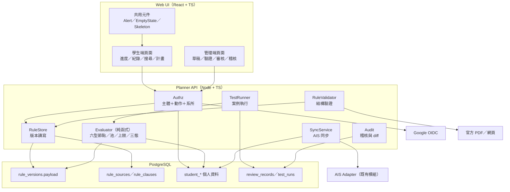
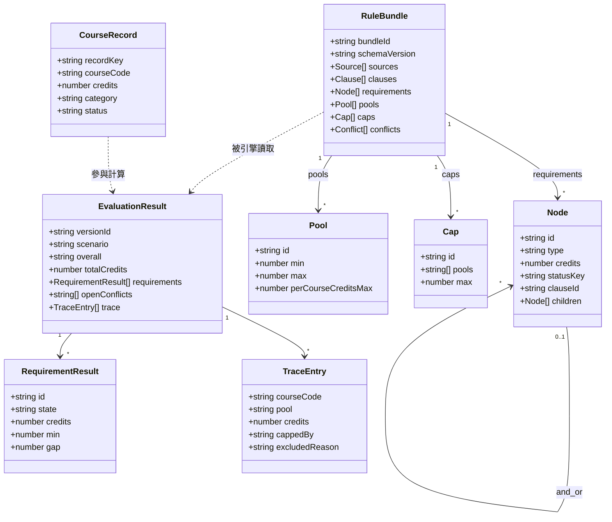
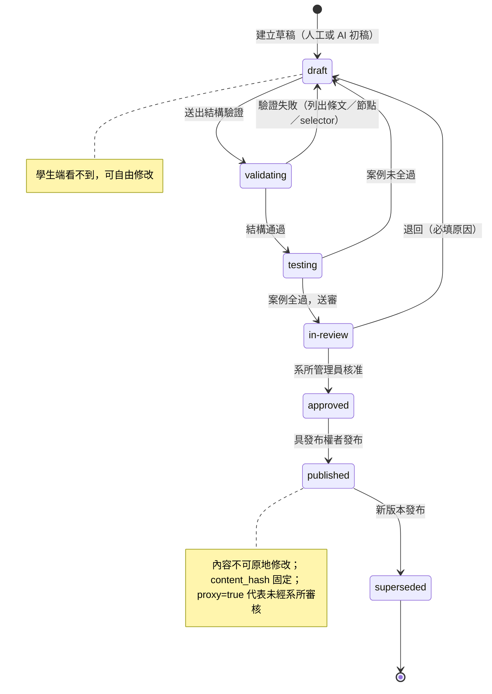
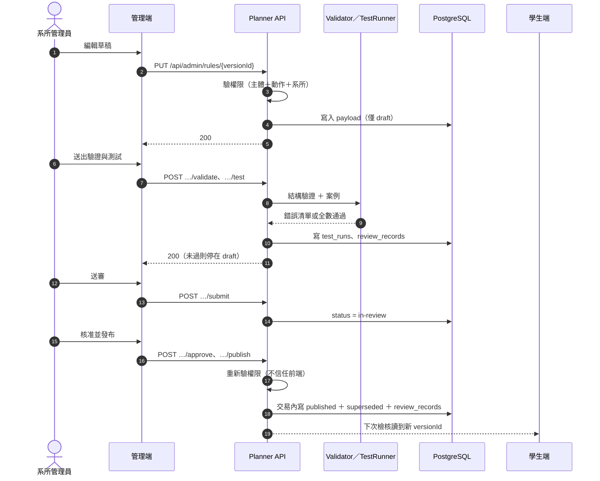
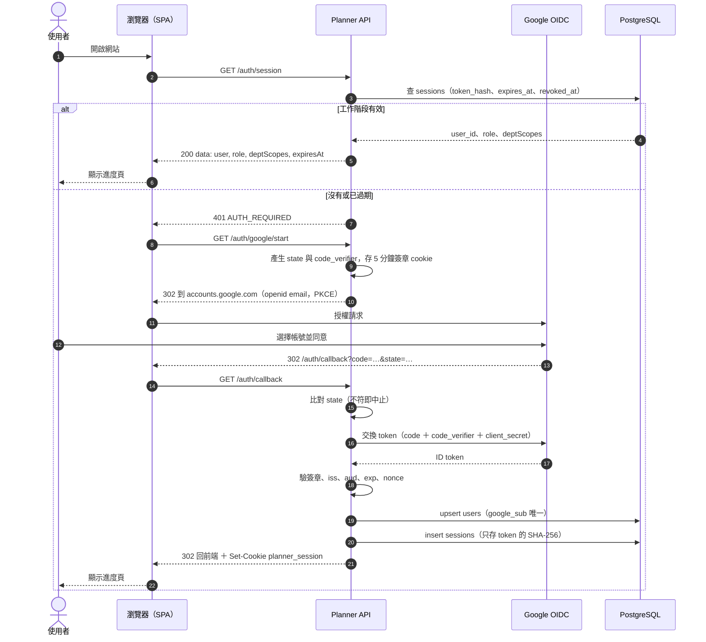
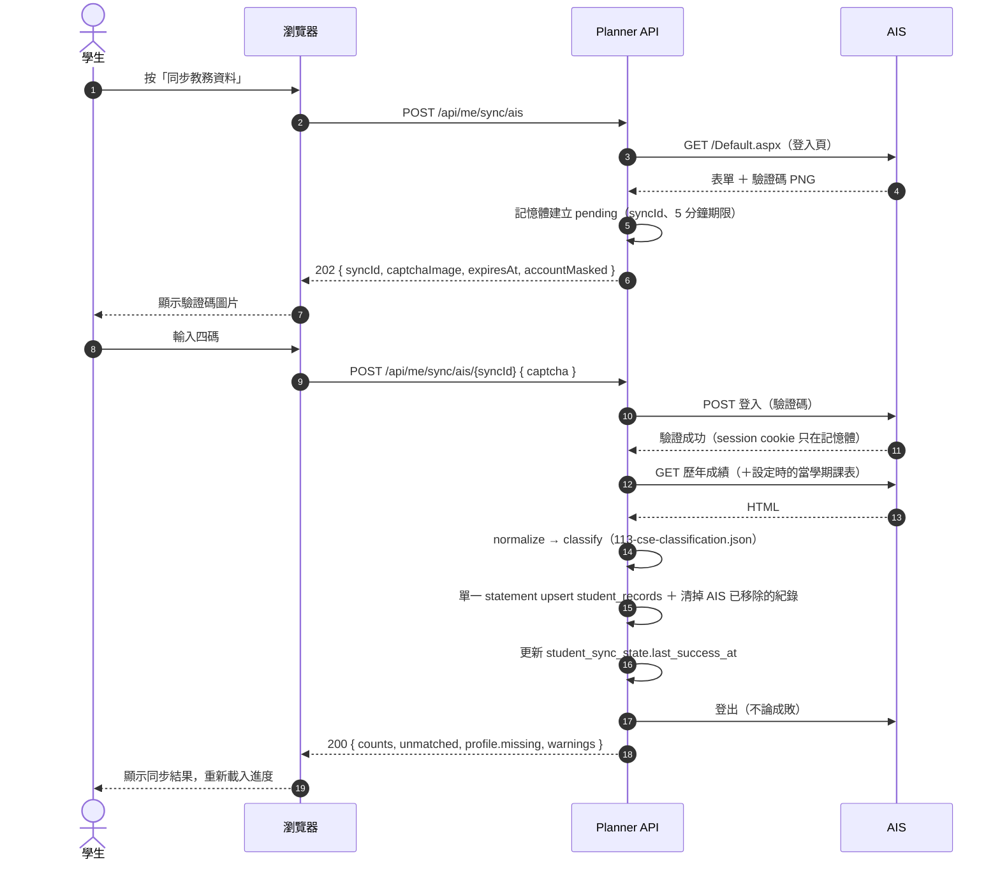

# 系統設計文件（SDD）v1.1

NTOUER Academic Planner｜Iteration 2 設計基準｜2026/11/16

本文件是 Lab 2 架構設計（C4 容器層）之後的展開：把容器拆成元件、把規則資料定成格式、把引擎演算法與發布流程寫到可實作的程度。需求依據為 [SRS](../requirements/srs.md) v0.9 與 [URD](../requirements/urd.md) v1.3；架構脈絡見 [C4 容器圖](diagrams/c4-container.png)（可編輯來源：[c4-design.drawio](diagrams/c4-design.drawio)）。

---

## 1. 這份設計要回答的五個問題

| # | 專案目標 | 本文件章節 | 驗證方式 |
| --- | --- | --- | --- |
| 1 | 人類可讀、可描述的海大各系修業規定紀錄方式 | 第 4 節、[規則描述模型](rule-model.md)、[schema](rule-bundle.schema.json) | 三系所表達性矩陣 + 結構驗證器 |
| 2 | 規則檢核引擎 | 第 5 節 | [spike](spike/) 27 項案例全數通過 |
| 3 | 邊緣案例：重複採計、上限、抵免、例外 | 第 6 節 | TC-29～TC-34 + spike 案例 4～7 |
| 4 | 可追溯原始條文與人工審核的發布流程 | 第 7 節 | 狀態機 + 稽核欄位 + 權限矩陣 |
| 5 | 學生介面與管理員介面 | 第 11 節 | 11 張線稿（學生 7、管理 4）＋缺口清單 |
| 6 | 誰能登入、怎麼確認身分 | 第 14 節 | OIDC 循序圖 ＋ TC-13 檢查點 |
| 7 | 環境、部署與可觀測性 | 第 15 節 | 日誌欄位、告警門檻、效能對策 |

結論先講：**五項都成立，且不需要為個別系所寫程式碼。** 已知表達不了的兩類規則（學年課連動、雙主修身分）已在第 12 節列為限制，不會假裝支援。

## 2. 設計原則

1. **規則即資料，版本不可變。** 規則包發布後形成唯讀快照；修改一律產生新版本，學生端永遠綁定 `ruleVersionId`。
2. **引擎不知道系名。** 引擎只認 schema 裡的六種節點與採計機制；新增系所＝新增一份 JSON，不改程式碼。
3. **同一份資料只計一次。** 由「池 + 優先序」保證；子集合用不消耗額度的 `credits` 節點表達，避免複製學分。
4. **不確定就顯示不確定。** 三態輸出；未解衝突、缺資料、未建模都不得顯示「已滿足」。
5. **每個數字都能回頭查。** 每個節點有 `clauseId`；每次檢核輸出 `ruleVersionId` 與逐筆採計 trace。

## 3. 容器到元件

沿用 Lab 2 的五個容器，展開如下：

```
┌ Web UI (React+TS) ─────────────────────────────────────────────┐
│ 學生端：進度／紀錄／搜尋／計畫／來源                              │
│ 管理端：規則編輯／測試／審核／發布                               │
└───────────────┬────────────────────────────────────────────────┘
                │ HTTPS / JSON（REST）
┌ Planner API (Node+TS) ─────────────────────────────────────────┐
│ Authz 身分與權限  │ RuleStore 規則讀寫  │ Audit 稽核             │
│ RuleValidator 結構驗證 │ TestRunner 規則測試 │ Evaluator 檢核   │
│ PlanService 計畫  │ CourseQuery 課程查詢 │ SyncService AIS      │
└──────┬──────────────────────┬───────────────────────┬──────────┘
       │                      │                       │
┌ PostgreSQL ────────┐  ┌ AIS Adapter ─┐      ┌ 課程資料庫 ─┐
│ 使用者／權限         │  │ 既有模組      │      │ 既有 NTOUer │
│ 規則包／版本／條文    │  └──────────────┘      └─────────────┘
│ 審核紀錄／測試證據    │
│ 個人修正／覆蓋／計畫  │
└────────────────────┘
```

**Evaluator 是純函式**：輸入（規則包、有效紀錄、情境、狀態）→ 輸出（三態結果、逐筆 trace），不碰資料庫、不呼叫外部服務。這讓同一份邏輯能同時用於 API、管理端預覽與自動測試（NFR-01 一致性的機制保證）。

### 3.1 元件圖（C4 Level 3 的內容）

Lab 2 的 C4 Context 與 Container 是可編輯的 drawio（[diagrams/](diagrams/)）。再往下一層的元件職責如下——用 Mermaid 表達，因為它會隨程式碼一起被 review，不必重新匯出圖片。



### 3.2 領域型別（UML 類別圖）

程式碼的型別在 `src/domain/types.ts`（I1）與規則包 schema，這裡只表達**關係**：一份規則包有多個節點與池，一次檢核產生一個結果，結果內含逐筆採計。



## 4. 規則資料設計

完整格式見 [規則描述模型](rule-model.md)，機器版見 [rule-bundle.schema.json](rule-bundle.schema.json)。摘要：

- **三層**：來源卡（哪份文件）→ 條文卡（原文逐字＋定位）→ 條件節點（機器可算）。
- **六種節點**：`total`、`pool`、`credits`、`courseSet`、`status`、`and`/`or`。
- **採計配置**：`pools`（含 `min`／`max`／`perCourseCreditsMax`）＋ `precedence`（同課歸屬順序）＋ `caps`（跨類上限）。
- **衝突**：`conflicts[]`，`resolution` 未解除時整體結果不得為「已滿足」。

### 4.1 表達性驗證

| 系所 | 結構特徵 | 表達結果 |
| --- | --- | --- |
| 資工 113 | 28／50／57；核心 12⊆系內 46；學程白名單；外系 8；博雅四領域上限＋跨域永續下限 | ✅ 完整表達（[113-cse.json](examples/113-cse.json)） |
| 商船 115 | 28／70／38；必修合計 98；管理級 18⊆主領域 38；外系 8；海上實習待確認 | ✅ 完整表達（[115-mmd.json](examples/115-mmd.json)） |
| 機械與機電 | 體育計入以 1 學分為限、通識選修以 2 學分為限 | ✅ 以 `caps`／`perCourseCreditsMax` 表達（[矩陣](rule-model.md#8-多系所驗證矩陣)） |

三系的共同結構（總學分、多池、子集合、上限、非學分條件、衝突）都在同一份 schema 內；差異只在資料，不在程式。

### 4.2 版本與識別

- 一個（系所 × 入學年度 × 學制）＝ 一個 `bundleId`，例如 `cse-113-day`。
- 發布產生 `versionNo`；`bundleId@versionNo` 不可變，內容雜湊 `contentHash` 用於偵測竄改。
- 條件節點 ID 跨版本穩定；刪除時保留並標 `retired`，避免學生個人覆蓋錯位（對應 SRS 8.5 覆蓋遷移規則）。

## 5. 規則引擎

### 5.1 輸入輸出

| 輸入 | 說明 |
| --- | --- |
| `bundle` | 已發布規則包（唯讀） |
| `records` | 有效修課紀錄（原始快照＋個人修正後） |
| `scenario` | `completed`／`inProgress`／`planned` |
| `statuses` | 非學分條件狀態：`met`／`notMet`／`unknown` |
| `overrides` | 個人條件覆蓋（可選，套用於節點結果） |

輸出：整體結果（三態）、總學分、各池學分、每個節點的狀態／實際值／門檻／缺額／計入課程、未解衝突、逐筆採計 trace（含被排除原因與被哪個上限截斷）。

### 5.2 演算法

```
1. 篩選：依 scenario 決定哪些紀錄參與（completed < inProgress < planned）
2. 去重：同一 courseCode 只留最佳一次（已及格 > 抵免/免修 > 修課中 > 計畫）
3. 歸池：依 precedence 逐池認領；每門課只進第一個符合的池
        套用 pool.max、pool.perCourseCreditsMax、caps[]
4. 總計：總學分 = 各池認領學分和（不變式：同一門課只貢獻一次）
5. 判節點：total/pool/credits/courseSet/status，再由下往上算 and/or
6. 匯總：任一必要節點 notMet → 未完成；否則有 unknown 或未解衝突 → 待確認；否則已滿足
```

**複雜度**：O(R × P + R × C)，R＝紀錄數（≤300）、P＝池數（≤6）、C＝上限數（≤10），單次檢核遠低於 1 毫秒；效能瓶頸會是資料庫與外部同步，不是引擎（對應 NFR-02）。

**決定性**：紀錄先依 `courseCode` 排序才歸池，同一輸入必得同一結果（NFR-01）；不依賴物件鍵序或時間。

### 5.3 個人覆蓋的套用位置

覆蓋只作用在「節點結果」這一層，不改學分計算：第 5 步算出每個節點的自動狀態後，若該節點有覆蓋則以覆蓋值取代，再往上重算 `and`/`or`。因此「把英文門檻設為達標」不會讓總學分增加，也不會消掉其他缺額（對應 SRS 8.3）。

### 5.4 與 I1 的差異

| 項目 | I1 現況（`src/engine/checkCredits.ts`） | I2 目標 |
| --- | --- | --- |
| 規則來源 | `src/data/testRules.ts` 寫死三條門檻（12／6／6） | 規則包 JSON，由資料庫載入 |
| 條件型別 | 只有「分類學分下限」 | 六型節點＋and/or |
| 重複採計 | 以 `recordId`／`courseCode` 去重 | 去重＋池優先序＋跨類上限 |
| 抵免／免修 | 不支援 | `transfer`／`waived` 狀態 |
| 三態 | 只有通過／不通過 | 加上 unknown 與未解衝突 |
| 追溯 | 回傳 `ruleVersion` 字串 | 回傳版本、條文、逐筆 trace |

I1 引擎會被替換而不是擴充；現有 8 個測試案例保留為回歸底線。

### 5.5 分類未確認時的判定（真實 AIS 資料的必要條件）

真實 AIS 成績只提供「必修／選修／通識」與課名，**沒有開課系所**，因此無法自動判定「系內選修 46」或「核心選修 12」。如果引擎把「還沒分類」的紀錄當成「不符合 selector」，就會把未知說成缺額，違反 SRS 8.4 與 NFR-06。

規則（`src/engine/ruleEngine.ts` 的 `credits` 節點）：

```
若 credits 條件算出 notMet，且本次參與計算的紀錄中存在「已採計但分類未確認」者
→ 節點狀態回 unknown（不是 notMet）
```

- 只影響 `credits`（tag 型學分條件）；`total`／`pool`／`courseSet`／`status` 不受影響，因為它們的分類依據是 category 或課號本身。
- `total` 仍計入這些學分：池的歸屬用 `owner` 兜底，不會漏算總學分。
- 已達門檻時就是 `met`，不會被未分類紀錄拖成 `unknown`。
- 對應測試：`src/engine/ruleEngine.unclassified.test.ts`（5 案例）。

**分類資料的來源**：`data/rules/113-cse-classification.json`，逐條附 `sourceId` 與 `locator`。只採用官方檢核表／修業規定明列的課名或 AIS 明確欄位（選別＝通識）；對不上就寫 `unknown` 並在同步結果的 `unmatched` 列出，讓使用者用個人修正處理，**不以課名相似度猜測**。這份資料與 Issue #18 的 `113-cse-coverage-map.json`（ruleId → clauseId）是兩件事：前者決定「這門課算哪一類」，後者決定「這條規則可追溯到哪一條文」。

## 6. 邊緣案例與測試設計

本節保留案例的設計意圖；每一條 `TC` 落在哪一層、目前有沒有可執行的證據、覆蓋率目標與 fixtures 策略，以 [test-plan.md](test-plan.md) 為準。

### 6.1 案例對照

| 案例 | 情境 | 預期 | 對應 |
| --- | --- | --- | --- |
| TC-29 採計上限 | 修 9 學分電資學院非指定學程 | 只認 6，總學分只加 6，trace 標記被截斷 | FR-03、NFR-01 |
| TC-30 重複採計 | 同一課同時列系內與外系；同課多筆 | 只計一次，歸屬單一池 | FR-03 |
| TC-31 抵免與免修 | 英語抵免 4 學分；數位邏輯實驗免修 | 抵免給學分並滿足條件；免修滿足必修但不給學分，必修學分缺 1 | FR-03、FR-05 |
| TC-32 例外衝突 | 電子商務學程兩份文件不一致 | 結果停在「待確認」，不得因其他條件達標而稱已滿足 | FR-03、NFR-06 |
| TC-33 多系所格式 | 同一引擎載入資工 113 與商船 115 | 兩份都正確計算，不改程式碼 | FR-11、FR-17 |
| TC-34 稽核追溯 | 檢視任一結果 | 可回查版本、條文定位、審核者、發布時間 | FR-12、FR-18、NFR-05 |

### 6.2 已完成的可行性驗證（spike）

[docs/design/spike](spike/) 是可執行的最小實作，`node docs/design/spike/run-cases.mjs` 目前 **27 項全數通過**，涵蓋：

- 結構驗證：正確樣本通過、錯誤條文參照被擋下；
- 完整達標但存在未解衝突 → 停在 `unconfirmed`；
- 缺額計算、系內不足；
- 採計上限：電資學院 9 學分只認 6；博雅單一領域超修不增加認列；
- 重複採計：同課多筆只計一次、歸屬單一池；
- 抵免（給學分）與免修（不給學分、必修缺 1）分開呈現；
- 未知狀態與衝突解除後可達 `complete`；
- 商船 136 學分、主領域 38 與管理級 18 同時滿足且不重複計入；
- 情境切換：修課中課程不計入已完成（129 → 135）。

spike 只驗證結構與演算法，不含權限、資料庫與 API；正式實作需補上並保留這些案例為回歸測試。

## 7. 發布流程與可追溯

### 7.1 狀態機



規則：

1. `draft` 不得供學生端使用；學生永遠讀 `published`。
2. 三次自動關卡（結構驗證、測試案例、審核）任一未過都不能發布。
3. `published` 不可原地修改；修改＝從目前版本複製成新 `draft`。
4. 後端在發布當下重新檢查權限（不信任前端送來的角色），並把檢查結果寫入稽核紀錄。

### 7.2 稽核紀錄欄位

| 欄位 | 說明 |
| --- | --- |
| `versionId` | 對應 `bundleId@versionNo` |
| `action` | `created`／`validated`／`tested`／`submitted`／`approved`／`rejected`／`published`／`superseded` |
| `actorId`／`actorRole` | 操作者與當下角色 |
| `actorDeptScope` | 操作者被授權的系所（跨系所請求會被拒並記錄） |
| `at` | 時間戳 |
| `detail` | 驗證錯誤、測試通過率、審核意見、退回原因 |
| `contentHash` | 該次動作時的內容雜湊，可證明「審的是哪一版」 |
| `diffFrom` | 相對前一版的變更摘要（新增／刪除／改門檻／改集合） |

**diff 的必要性**：系所管理員審核時看的是「改了什麼」，不是整份規則。diff 由結構比較產生（節點 id、型別、門檻、課程集合、組合關係），不依賴 AI 語意理解。

### 7.3 學生端可見的來源資訊

每個條件的詳情頁顯示：條件名稱、原文摘錄與定位、來源文件標題與連結、規則版本、發布者與是否經系所審核、最後更新時間。這是「規定來源」目標的落地方式。

### 7.4 發布循序圖（含後端重驗權限）



**重點**：`approve` 與 `publish` 各自重驗權限與內容雜湊；前端送來的角色一律不採信（見第 8 節）。

## 8. 權限設計

| 能力 | 學生 | 系所管理員 | 系統管理員 |
| --- | --- | --- | --- |
| 讀已發布規則 | ✓ | ✓ | ✓ |
| 建立／編輯草稿 | ✗ | 僅自己系所 | 全部 |
| 跑結構驗證與測試 | ✗ | 僅自己系所 | 全部 |
| 審核（核准／退回） | ✗ | 僅自己系所 | 可代理（需標示代理） |
| 發布 | ✗ | 僅自己系所 | 系所無管理員時 |
| 指派／移除系所管理員 | ✗ | ✗ | ✓ |
| 讀個人資料 | 僅自己 | 統計去識別（不讀個別紀錄） | 僅維運必要且需稽核 |
| 刪除已發布版本 | ✗ | ✗ | ✗（只能 supersede） |

**實作要點**：權限檢查放在 API 的中介層，以「主體 + 動作 + 資源（系所）」三元組判斷；UI 隱藏只是體驗，不是安全機制。系統管理員的「代理發布」必須在版本上標記 `proxy: true`，避免日後誤認為系所已審核。

## 9. 資料模型（PostgreSQL）

| 表 | 主要欄位 | 說明 |
| --- | --- | --- |
| `users` | id、google_sub、email、role、dept_id、entry_year、program | 角色由後端決定；學籍用來找適用規則包 |
| `departments` | id、name、college、active | 系所清單，供擴充 |
| `department_admins` | dept_id、user_id、granted_by、granted_at、revoked_at | 一系可多名 |
| `rule_bundles` | bundle_id、dept_id、entry_year、program | 規則包身分 |
| `rule_versions` | version_id、bundle_id、version_no、status、payload(jsonb)、content_hash、published_by、published_at、reviewed_by | 版本與內容 |
| `rule_sources` | source_id、version_id、title、url、locator、sha256 | 來源卡 |
| `rule_clauses` | clause_id、version_id、source_id、locator、text、reading、status | 條文卡 |
| `review_records` | id、version_id、actor_id、action、detail、content_hash、at | 稽核 |
| `test_runs` | id、version_id、suite、passed、failed、detail、at | 測試證據 |
| `student_records` | user_id、record_key、course_code、credits、status、category、tags、owner、raw(jsonb)、synced_at | 原始快照；category／tags／owner 是引擎 selector 的輸入 |
| `student_overrides` | user_id、record_key、field、value、updated_at | 個人修正 |
| `student_condition_overrides` | user_id、bundle_id、requirement_id、state、updated_at | 個人覆蓋 |
| `student_plans` | user_id、term、course_code、section_id、sort | 修課計畫 |
| `sessions` | id、user_id、token_hash、expires_at、revoked_at | 登入工作階段（登出即撤銷） |
| `student_sync_state` | user_id、last_success_at、last_attempt_at、last_result、last_error_code | 同步狀態（TC-12 的「最後成功時間」不能從紀錄推） |

`payload` 以 jsonb 存整份規則包，另以 `rule_sources`／`rule_clauses` 建索引供查詢與 diff；好處是引擎只需一個查詢就能拿到完整版本，且版本天生不可變。

本節只是概覽（13 張核心表 ＋ 2 張狀態表，共 15 張）。欄位型別、`NOT NULL`、主鍵與外鍵、每條索引存在的理由、遷移順序、seed、快取層級與保留政策，一律以 [database-design.md](database-design.md) 為準；兩邊衝突時修本節。

## 10. API 介面（草案）

本節保留端點概覽；統一回應 envelope、錯誤碼表、版本策略、認證標頭與前三個端點的完整規格，以 [api-spec.md](api-spec.md) 與 [openapi.yaml](openapi.yaml) 為準。

| 方法 | 路徑 | 用途 | 權限 |
| --- | --- | --- | --- |
| POST | `/api/check` | 檢核（bundle 版本、情境、狀態） | 學生本人 |
| GET | `/api/me/progress` | 三情境進度與缺額 | 學生本人 |
| GET | `/api/rules?dept=cse&year=113` | 取最新已發布版本 | 已登入 |
| GET | `/api/rules/{versionId}` | 取特定版本（含條文與來源） | 已登入 |
| POST | `/api/admin/rules/{bundleId}/draft` | 建立草稿（可由 AI 初稿帶入） | 系所管理員 |
| PUT | `/api/admin/rules/{versionId}` | 更新草稿 | 系所管理員 |
| POST | `/api/admin/rules/{versionId}/validate` | 結構驗證 | 系所管理員 |
| POST | `/api/admin/rules/{versionId}/test` | 跑測試案例 | 系所管理員 |
| POST | `/api/admin/rules/{versionId}/submit` | 送審 | 系所管理員 |
| POST | `/api/admin/rules/{versionId}/approve`｜`/reject` | 審核 | 系所管理員 |
| POST | `/api/admin/rules/{versionId}/publish` | 發布 | 系所管理員／系統管理員（無管理員時） |
| GET | `/api/admin/rules/{versionId}/diff` | 與前一版差異 | 系所管理員 |
| GET | `/api/admin/audit?versionId=` | 稽核紀錄 | 系所管理員／系統管理員 |
| POST | `/api/admin/departments/{deptId}/admins` | 指派管理員 | 系統管理員 |

檢查端點回傳範例（節錄）：

```jsonc
{
  "bundleId": "cse-113-day", "versionId": "cse-113-day@3", "scenario": "completed",
  "overall": "unconfirmed",
  "totalCredits": 135,
  "requirements": [
    { "id": "R06", "name": "系內選修 46", "state": "met", "credits": 46, "min": 46, "gap": 0 },
    { "id": "R15", "name": "英文畢業門檻", "state": "unknown", "statusKey": "englishThreshold" }
  ],
  "openConflicts": ["X01"],
  "trace": [{ "courseCode": "電資共通1", "pool": "inner", "credits": 3, "cappedBy": "CAP-COLLEGE" }]
}
```

## 11. 介面設計

本節保留畫面與線稿的對應關係；design tokens、sitemap、使用流程、四種狀態（Loading／Empty／Error／無權限）、元件清單與無障礙要求，以 [ui-ux-spec.md](ui-ux-spec.md) 為準。線稿沿用、不重畫。

### 11.1 學生端（沿用既有線稿）

| 畫面 | 對應線稿 | 內容 |
| --- | --- | --- |
| 登入與同步 | AP-UI-01 | Google 登入、AIS 同步、快照時間 |
| 畢業進度 | AP-UI-02 | 三情境切換、必要條件清單、缺額、整體結果 |
| 條件詳情 | AP-UI-03 | 門檻、計入課程、被排除原因、來源、覆蓋設定 |
| 修課紀錄 | AP-UI-04 | 原始／修正對照、恢復 |
| 課程搜尋與計畫 | AP-UI-05 | 搜尋、歷年開課、加入計畫、衝堂 |

新增（本版補充）：**來源檢視面板**—從條件直接跳到條文卡與官方文件定位，對應「規定來源」目標。

### 11.2 管理端

| 畫面 | 對應線稿 | 內容 |
| --- | --- | --- |
| 規則管理總覽 | AP-UI-06 | 規則包清單、版本狀態、來源登錄、草稿預覽、發布入口 |
| 草稿編輯 | AP-UI-06 | 節點樹、條文卡並排、AI 初稿匯入（標示草稿來源） |
| 驗證與測試 | AP-UI-08 | 結構錯誤清單（指出條文／節點／selector）、測試案例逐項結果、送審按鈕僅在通過後出現 |
| 審核與差異 | AP-UI-09 | 結構 diff（新增／變更／刪除／不變）、審核意見、核准與退回、發布後 supersede 舊版 |
| 稽核紀錄 | AP-UI-10 | 版本時間軸（created→published）、操作者與角色、內容雜湊 |
| 系所管理員指派 | AP-UI-11 | 系所清單、已指派／代理狀態、以 Google 身分指派與撤銷 |

管理端四張線稿（UI-08～UI-11）於 v0.9 補齊，與學生端共用同一套視覺語言：左「操作前」、右「操作後」，每一步都對應可驗收的狀態變化。仍未畫出的部分：批次匯入多年度規則、課程等價表維護、通知與待辦佇列；這些列為 I3 後續介面。

## 12. 可行性與風險

### 12.1 技術可行性

| 項目 | 判斷 | 依據 |
| --- | --- | --- |
| 規則格式是否夠用 | ✅ 三系所驗證 | 第 4.1 節 |
| 引擎是否算得對 | ✅ spike 27 項 | 第 6.2 節 |
| 效能 | ✅ 樂觀 | 單次檢核 O(300×6)，遠低於 1 秒目標 |
| 發布流程 | ✅ 可實作 | 狀態機＋稽核表，無外部依賴 |
| 多系所擴充 | ✅ 資料驅動 | 新增系所＝新增 JSON＋管理員指派 |

### 12.2 風險

| 風險 | 影響 | 對策 |
| --- | --- | --- |
| 課程課號與課名對應未建 | 規則只能以課名比對，易誤判 | I2 先建 113 資工課號對應表；未對應者顯示待確認 |
| AIS 實際欄位未知 | 抵免／免修／成績狀態可能取不到 | 以「未知」呈現並允許個人修正（FR-05） |
| 各系白名單取得不易 | 學程採計只能部分支援 | 缺口列清單，不猜測（SRS 8.7.2） |
| 來源衝突（電子商務、主領域 36/38） | 結果正確性爭議 | 2026/11/16 決議暫時擱置追查，維持 `conflicts` 擋住完整達標並公開顯示；恢復處理需具適用效力公告或系所決策 |
| 系所管理員人選未定 | 發布流程無法實測 | 以系統管理員代理發布並標記 `proxy` |
| AI 解析品質不穩 | 草稿錯誤多，審核成本上升 | AI 只產草稿，必經結構驗證與測試；解析失敗回退人工，不阻擋發布 |
| 學年課連動等未支援規則 | 少數系所算不準 | 明列限制，不宣稱完整支援 |

## 13. Iteration 2 交付與完成定義

| 工作 | 產出 | 完成定義 |
| --- | --- | --- |
| 規則格式與驗證器 | schema、validator、2 份樣本 | 三系所樣本通過驗證；錯誤參照被擋 |
| 引擎正式化 | `engine` 套件＋回歸測試 | TC-01～TC-08 與 TC-29～TC-33 通過 |
| 資料庫與 API | 遷移腳本、檢核與規則端點 | 同一版本可重現結果；跨使用者被拒 |
| 發布流程 | 狀態機、稽核、diff、權限檢查 | TC-18、TC-19、TC-27、TC-34 通過 |
| 管理端 UI | 草稿編輯、驗證測試（UI-08）、審核差異（UI-09）、稽核（UI-10）、管理員指派（UI-11） | 可從草稿走到發布，全程留紀錄；四張線稿已補（v0.9） |
| AI 草稿匯入 | PDF → 結構化草稿，標示來源與原文定位 | TC-21 通過；解析失敗可回退人工且不阻擋發布 |
| 學生端整合 | 真實規則取代測試規則 | 113 資工可顯示完整 46 條覆蓋與來源 |

**Definition of Done**：SRS 第 10.2 節對應案例通過、每次檢核可回查版本與條文、未解衝突與未知狀態不會顯示「已滿足」、跨系所與跨使用者請求被後端拒絕。

## 14. 身分驗證（AuthN）

決策與替代方案見 [ADR-0003](adr/0003-google-oidc-identity.md)；本節只寫流程、失敗處理與檢查點。

### 14.1 登入循序圖



### 14.2 失敗處理

| 情況 | 伺服器行為 | 使用者看到 |
| --- | --- | --- |
| `state` 不符或已過期 | 中止，不建立 session，記一筆稽核 | 登入失敗頁；**網址不帶錯誤細節** |
| Google 回 `error=access_denied` | 同上 | 「你取消了登入」 |
| ID token 驗證失敗 | 中止；記 `error` 等級日誌（不含 token） | 「登入暫時無法完成，請再試一次」 |
| 使用者不存在 | 以 `google_sub` 建立 `student` | 直接進入進度頁 |
| 登出 | `sessions.revoked_at = now()`，清 cookie | 回到登入頁 |
| 系所管理員被撤銷 | 下一個請求的權限檢查就失效（不快取角色） | 管理端入口消失；直接打 API 得 403 |

### 14.3 檢查點（對應 TC-13）

- cookie 屬性必須是 `HttpOnly; Secure; SameSite=Lax; Path=/`。
- 資料庫只存 `token_hash`；任何日誌不得出現原始 token 或 ID token。
- 使用者 A 改 `userId` 打 B 的資料 → 403；`deptScopes` 以外的系所操作 → 403 `AUTH_DEPT_OUT_OF_SCOPE`。
- 登出後用同一 cookie 再打 `GET /auth/session` → 401。

### 14.4 AIS 教務資料同步（FR-02）

Google 身分（14.1）與 AIS 登入是**兩件事**：前者是 Planner 的帳戶，後者只是取得修課資料的手段，不建立 Planner 的工作階段。

**流程（三段，見 api-spec §7.6）**



**帳密的邊界（NFR-04）**

| 位置 | 允許 | 說明 |
| --- | --- | --- |
| 部署環境變數／`.env.local` | ✅ | `AIS_ACCOUNT`／`AIS_PASSWORD`；檔案已 gitignore，只在伺服器上 |
| 伺服器記憶體（pending） | ✅ | 登入完成即丟棄；pending 有 TTL，取消／逾時就清掉 |
| 資料庫 | ❌ | 只存正規化後的修課快照與 `student_sync_state` |
| 日誌／回應／前端儲存 | ❌ | 回應只給 `accountMasked`；錯誤訊息不含帳密 |

**一次同步只收一次驗證碼**：AIS 驗證碼錯誤時會換一張新圖並重試，但本流程在使用者送出後就把輸入通道關閉——第二次要求會直接失敗（`CAPTCHA_RETRY_REQUIRED`），使用者重新開始。這樣不會出現「伺服器在等人輸入、前端卻已經顯示完成」的鬼狀態。

**分類與未知**：課名對不到官方清單的課程一律記 `category=unknown`，列在 `unmatched`，並讓 §5.5 的規則把相關學分條件停在 `unknown`。**不會**用課名相似度猜系內／外系。

**已知限制（I2）**：目前的部署模型是「一個學生、一份 AIS 憑證」。多使用者上線前必須改成每位使用者各自的 AIS 憑證（或一次性的授權流程），並補上相應的稽核；在那之前 `AIS_ACCOUNT` 只能是部署者本人，文件與畫面都要這樣寫，不能假裝支援多人。

## 15. 環境、部署與可觀測性

決策見 [ADR-0006](adr/0006-deployment-platform-and-ci.md)。本節寫「跑起來之後怎麼知道它正常」。

### 15.1 環境

| 環境 | 用途 | 資料庫 | 現況 |
| --- | --- | --- | --- |
| Dev | 本機開發；Vite dev server（5173，`/api`、`/auth` proxy 到 3000）或同源 3000 | 可重建（migrate ＋ seed） | **已具備** |
| Prod／Demo | 學生與管理者實際使用；同源單一服務（API 也服務 `dist/`） | 持久、需備份 | **可部署產出已交付**：`Dockerfile`（multi-stage、非 root、HEALTHCHECK）、`compose.yaml`（db ＋ app）、`scripts/docker-entrypoint.sh`、`.dockerignore`、`.env.example` |

「可部署」不等於「已部署」：目前沒有對外主機，I2 的驗證都在本機同源 3000 上完成。

不設 Staging：5 人團隊多一層環境只有維運成本（ADR-0006）。

### 15.2 分支策略與 CI

| 分支 | 規則 |
| --- | --- |
| `main` | 只能經 PR 合併；需 `web`、`docs` 兩個 check 通過；需 1 個 approving review |
| `feat/*`、`fix/*`、`docs/*`、`ci/*` | 短命分支，合併後刪除 |

CI 兩個 job：`web`（npm ci → build → test）、`docs`（spike 27 項 → 連結檢查 → OpenAPI lint）。**不使用 secrets、不連外部服務**；紅燈不得用 `continue-on-error` 掩蓋。

### 15.3 部署流程

**一鍵本機／示範（同源單一服務）**

```bash
docker compose up -d --build      # db（127.0.0.1:5433）＋ app（127.0.0.1:3000）
curl -s http://127.0.0.1:3000/healthz
```

`scripts/docker-entrypoint.sh` 依序做：等資料庫 → `node scripts/db/migrate.mjs` →（`SEED_ON_START=1` 時）`node scripts/db/seed.mjs` → 啟動 API。這只是把 ADR-0004 的「部署者手動跑遷移」自動化，同一支腳本仍可手動執行；正式環境把 `SEED_ON_START` 留空（預設 `0`）。

**映像內容**：`node:22-alpine` multi-stage；runtime 只帶 production 相依＋`tsx`、`dist/`、`server/`、`src/engine/`、`db/`、`scripts/`、`data/`、`docs/design/examples/`；以 `node` 使用者執行、不掛載原始碼。API 同時服務 `dist/`（`server/static.ts`），所以 OIDC 的 redirect URI 與 cookie 都留在同一個 origin。

**容器環境變數**：`HOST=0.0.0.0`（容器內必須，否則 port mapping 收不到）、`DATABASE_URL`（由 compose 覆蓋成 `db:5432`）、`PORT`、`SESSION_SECRET`、`GOOGLE_CLIENT_ID`／`GOOGLE_CLIENT_SECRET`／`GOOGLE_REDIRECT_URI`（與 14.1 一致：`http://localhost:3000/auth/callback`）、`AIS_*`、`SEED_ON_START`。compose 內的 `planner/planner` 只是本機開發值。

**取得主機後的步驟**

1. `npm run build` → `dist/`（或直接 build 映像）
2. 套用遷移（entrypoint 會做，或手動 `npm run db:migrate`）
3. 重啟服務並打 `/healthz`
4. 以真實帳號走一次：Google 登入 → 同步 AIS → 進度頁，確認規則版本與資料時間正確

`HEALTHCHECK` 只是「每 15 秒打一次 `/healthz`（含 `select 1`）」，容器 healthy 不等於 §15.5 的監控已到位。

### 15.4 日誌欄位

一行一筆 JSON 輸出到 stdout（由平台收集）。**不得出現帳密、token、Cookie、完整學號。**

| 欄位 | 型別 | 說明 |
| --- | --- | --- |
| `ts` | string | ISO 8601 帶時區 |
| `level` | string | `info`／`warn`／`error` |
| `requestId` | string | 與回應的 `X-Request-Id` 相同 |
| `route` | string | 路由樣板（`/api/rules/{versionId}`），不是實際 URL |
| `method` | string | HTTP 方法 |
| `status` | number | 回應狀態碼 |
| `durationMs` | number | 伺服器處理時間 |
| `userId` | string? | 已登入時的使用者 UUID（不含 email） |
| `ruleVersionId` | string? | 與規則版本相關的請求才填 |
| `errorCode` | string? | 對應 `api-spec.md` §4 的 `code` |
| `module` | string | `auth`／`rules`／`eval`／`sync`／`db` |

### 15.5 監控指標與告警

| 指標 | 來源 | 告警門檻 | 為什麼是這個門檻 |
| --- | --- | --- | --- |
| 5xx 比率 | 日誌 `status >= 500` | 5 分鐘內 > 1% | 對應 NFR-03 的錯誤率上限 |
| 檢核端點 p95 | 日誌 `durationMs`（`route=/api/me/progress`） | > 1 秒 | 對應 NFR-02 |
| 同步失敗率 | `errorCode = SYNC_FAILED` | 連續 3 次失敗 | 單次失敗可能是 AIS 抖動，連續才有意義 |
| 資料庫連線數 | `pg_stat_activity` | > 80% 上限 | 池用盡會讓所有請求排隊 |
| 未解衝突版本被發布 | `payload.conflicts[].resolution` 為空且 `status=published` | 出現即告警 | 這是「該擋卻沒擋」，屬 S1 |

I2 沒有人力做完整監控：先實作 `/healthz` 與結構化日誌，其餘指標以 `scripts/` 的查詢腳本人工檢查。**不假裝已有儀表板。**

### 15.6 效能瓶頸與對策

| 瓶頸 | 為什麼會痛 | 對策 |
| --- | --- | --- |
| **每次檢核都讀整份 `payload`** | 40–100 KB × 每次請求 | 行程內 LRU（以 `version_id` 為鍵；版本不可變，所以不需要失效） |
| **AIS 同步** | 外部服務，等待時間不可控 | 只在使用者主動同步時執行；失敗保留前次快照（TC-12）；不做背景輪詢 |
| **稽核表只增不減** | `review_records` 會長大 | `(version_id, at)` 索引支撐時間軸查詢；不做全表掃描 |
| **規則版本變多** | 取最新已發布版本要掃 | 部分索引只掃 `published`（[database-design.md](database-design.md) §4） |
| **引擎本身** | O(R×P + R×C)，R ≤ 300、P ≤ 6、C ≤ 10 | 不需要優化；實測前不加複雜度 |

## 16. 未決事項

1. 管理端是否要支援「批次匯入多年度規則」，或一次只處理一個年度。
2. 課程等價表（舊課號→新課號）由誰維護、放在哪一層。
3. 系所管理員的離職／交接流程（目前只有指派與移除）。
4. 是否對外開放規則包的唯讀 API，讓其他團隊驗證。
