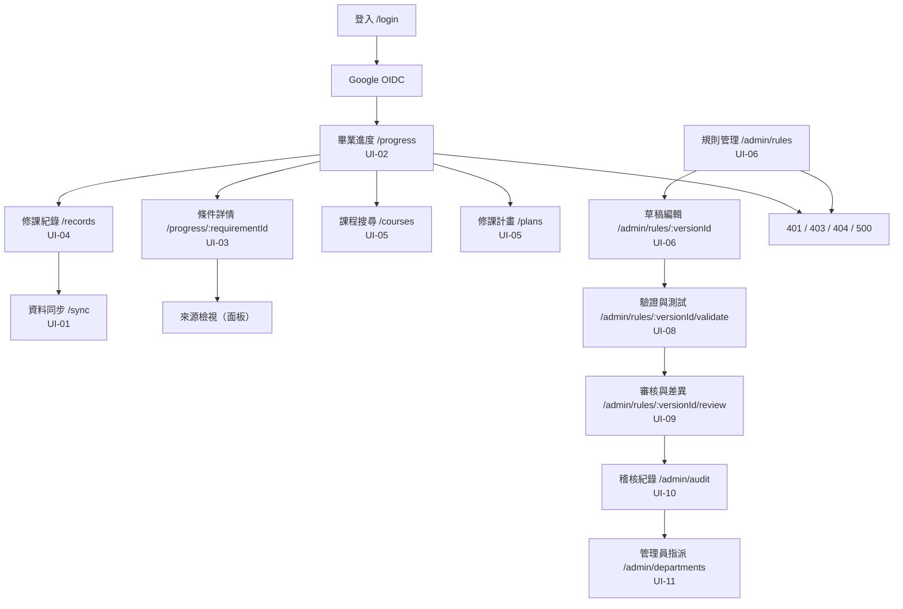
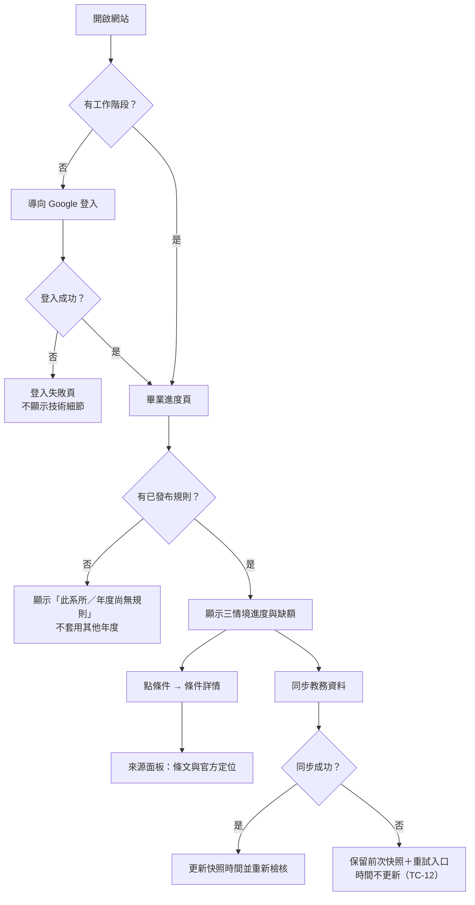
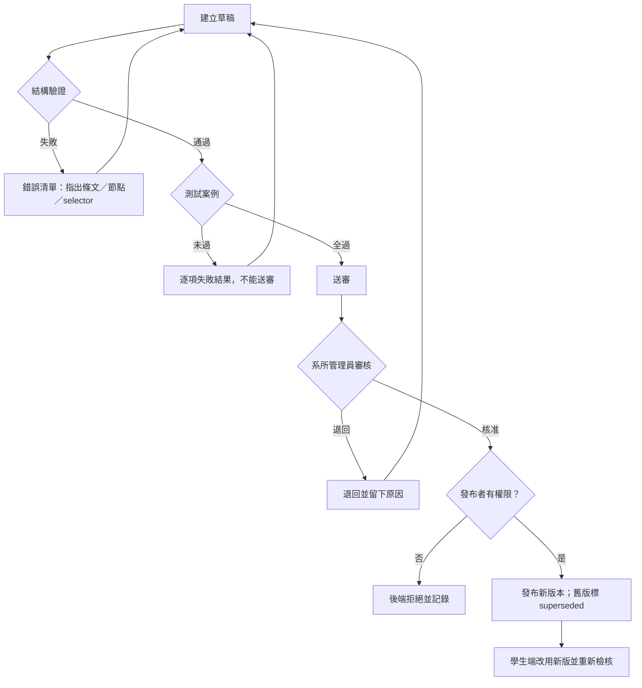

# UI/UX 規格

Extends: system-design.md §11（介面設計）

NTOUER Academic Planner｜Iteration 2｜2026/11/16

本文件把「畫面長什麼樣」從 11 張線稿與 `src/styles.css` 抽成可實作的規則：sitemap、使用流程、design tokens、元件清單、四種狀態（Loading／Empty／Error／無權限）與無障礙要求。

**線稿沿用、不重畫。** 線稿是需求的視覺依據（放在 [docs/requirements/wireframes/](../requirements/wireframes/index.html)），本文件只補它們沒說的部分：顏色、間距、狀態、鍵盤與對比。

前置決策見 [ADR-0003](adr/0003-google-oidc-identity.md)（登入與工作階段）、[api-spec.md](api-spec.md)（錯誤碼決定畫面文案）、[database-design.md](database-design.md)（資料形狀）。

---

## 1. 設計原則

1. **沿用既有視覺語言。** 顏色、字體、卡片與表格樣式都取自 `src/styles.css`，不引入第二套設計系統。
2. **狀態不只靠顏色。** 每個狀態同時有文字標籤（通過／不通過／尚未確認），顏色只是輔助。
3. **不確定就顯示不確定。** 引擎三態（`met`／`notMet`／`unknown`）在畫面上必須看得出來哪一個是「還不知道」，不能與「沒通過」混用（NFR-06）。
4. **每次結果都能回查。** 規則版本、來源、同步時間必須顯示在結果附近，不是藏在設定頁。
5. **手機優先可操作。** 390×844 下主要流程不需橫向捲動；寬表格可局部捲動但要有提示（NFR-07）。

## 2. Sitemap

| 線稿 | 頁面 | 角色 | 主要動作 |
| --- | --- | --- | --- |
| [UI-01](../requirements/wireframes/assets/ui01-sync.png) | 登入與資料同步 | 學生 | 登入、同步、看快照時間 |
| [UI-02](../requirements/wireframes/assets/ui02-progress.png) | 畢業進度首頁 | 學生 | 切換三情境、看缺額 |
| [UI-03](../requirements/wireframes/assets/ui03-override.png) | 條件詳情與手動設定 | 學生 | 看門檻與採計、設覆蓋 |
| [UI-04](../requirements/wireframes/assets/ui04-records.png) | 修課紀錄 | 學生 | 原始／修正對照、恢復 |
| [UI-05](../requirements/wireframes/assets/ui05-plan.png) | 課程搜尋與學期規劃 | 學生 | 搜尋、加入計畫 |
| [UI-06](../requirements/wireframes/assets/ui06-rules.png) | 規則管理與草稿 | 系所管理員 | 編輯草稿、預覽 |
| [UI-08](../requirements/wireframes/assets/ui08-admin-validate.png) | 規則驗證與測試 | 系所管理員 | 跑驗證與案例、送審 |
| [UI-09](../requirements/wireframes/assets/ui09-admin-review.png) | 審核與差異 | 系所管理員 | 核准／退回、看 diff |
| [UI-10](../requirements/wireframes/assets/ui10-admin-audit.png) | 稽核紀錄 | 系所管理員／系統管理員 | 看版本時間軸 |
| [UI-11](../requirements/wireframes/assets/ui11-admin-admins.png) | 系所管理員指派 | 系統管理員 | 指派／撤銷 |
| [UI-07](../requirements/wireframes/assets/ui07-demo.png) | I1 Demo（歷史） | 展示 | 保留為 I1 對照 |

## 3. 使用流程

### 3.1 學生：從登入到看見缺額

關鍵規則：沒有適用規則時**不改套其他年度**；同步失敗**不清空**既有資料；未知狀態顯示「尚未確認」而不是「未通過」。

### 3.2 管理員：從草稿到發布

關鍵規則：送審按鈕只在驗證與測試都通過後出現；發布後不可原地修改；系統管理員代理發布必須標示「未經系所審核」。

## 4. Design tokens

### 4.1 現況來源

`src/styles.css` 目前只有 7 個 CSS 變數，其餘顏色散落在規則裡。下表把兩者一起收斂成 token 名稱，**值不變**。

| Token | 現值 | 用途 | 現況 |
| --- | --- | --- | --- |
| `--ink` | `#12343d` | 標題、主要數字、深色底 | 已是變數 |
| `--muted` | `#5c7077` | 次要文字、說明、表頭 | 已是變數 |
| `--line` | `#d9e2e5` | 卡片與區塊邊框 | 已是變數 |
| `--teal` | `#086d65` | 主色：主要動作、已達標、已採計 | 已是變數 |
| `--teal-tint` | `#e9f4f1` | 主色淡底：選取態、達標摘要 | 已是變數 |
| `--warning` | `#915317` | 警示文字：未達標 | 已是變數 |
| `--warning-tint` | `#fff4e4` | 警示底 | 已是變數 |
| `--bg` | `#f3f6f7` | 頁面底色 | 硬編碼於 `:root` |
| `--surface` | `#ffffff` | 卡片、面板、表頭以外的底 | 硬編碼 |
| `--text-body` | `#243b43` | 內文 | 硬編碼於 `:root` |
| `--teal-hover` | `#04554e` | 主要按鈕 hover | 硬編碼 |
| `--teal-active` | `#03473f` | 主要按鈕 active | 硬編碼 |
| `--focus` | `#167e98` | 鍵盤焦點環（3px、offset 4px） | 硬編碼 |
| `--line-subtle` | `#e8eef0` | 表格與區塊內分隔線 | 硬編碼（另有 `#e7edef`、`#e9edef` 兩個近似值） |
| `--surface-alt` | `#f6f8f9` | 表頭底、說明區底 | 硬編碼 |
| `--surface-hover` | `#f0f5f5` | 清單項 hover | 硬編碼 |
| `--tag-bg` | `#eef3f5` | 版本標籤底 | 硬編碼 |
| `--state-met-fg` / `-bg` | `#086258` / `#e8f3ee` | 狀態：及格／達標 | 硬編碼 |
| `--state-unmet-fg` / `-bg` | `#9b3c3c` / `#fbecec` | 狀態：不及格 | 硬編碼 |
| `--state-unknown-fg` / `-bg` | `#645775` / `#f1edf6` | 狀態：尚未確認 | 硬編碼 |
| `--state-pending-fg` / `-bg` | `#44636f` / `#eaf0f3` | 狀態：待檢核 | 硬編碼 |
| `--notice-fg` / `-bg` / `-border` | `#78501d` / `#fff0d6` / `#e9d6b4` | 測試範圍提示條 | 硬編碼 |
| `--track` | `#e7edef` | 進度條底 | 硬編碼 |
| `--track-unmet` | `#b77932` | 未達標進度條 | 硬編碼 |
| `--empty-icon` | `#708a93` | 空狀態圖示 | 硬編碼 |

**收斂建議**：`#e8eef0`／`#e7edef`／`#e9edef` 三個只差 1–2 階的灰，統一為 `--line-subtle`；`#eef3f5`（標籤底）與 `#f0f5f5`（hover 底）用途不同但視覺相近，保留兩個名稱以避免誤用。這屬程式碼變更，不屬於本文件。

### 4.2 字體

| Token | 值 | 用途 |
| --- | --- | --- |
| `--font-sans` | `"Noto Sans TC", "PingFang TC", "Microsoft JhengHei", sans-serif` | 全部文字 |
| `--num` | `font-variant-numeric: tabular-nums` | 所有數字（學分、筆數、日期） |

等寬數字是必要的：缺額與學分會並排比較，數字不對齊就看不出大小關係。

**字級**（現值 → 建議收斂）

| 角色 | 現值 | 建議 token |
| --- | --- | --- |
| 學分大數字 | `2.3rem` / `700` / `-0.03em` | `--text-display` |
| 頁面主標 | `1.65rem` / `-0.025em` | `--text-h1` |
| 品牌標題 | `1.35rem` / `750` / `-0.025em` | `--text-h2` |
| 區塊標題 | `1rem` / `700` | `--text-h3` |
| 卡片標題 | `.81rem`–`.94rem` / `650` | `--text-title` |
| 內文 | `.875rem` / `1.7` | `--text-body` |
| 說明 | `.75rem`–`.8rem` | `--text-sm` |
| 表格與標籤 | `.6rem`–`.73rem` | `--text-xs` |

現況有 20 多個介於 `.6`–`.875` 的字級，建議收斂為 **4 級**（`--text-xs` `.7rem`、`--text-sm` `.78rem`、`--text-body` `.875rem`、`--text-title` `1rem`）。收斂會改變部分畫面像素，屬 UI 工作，不在本輪。

**字重**：現用 `400`／`500`／`550`／`650`／`700`／`750`，建議收斂為 3 級 `400`（內文）／`550`（強調）／`750`（標題與數字）。

### 4.3 間距與尺寸

| Token | 值 | 用途 |
| --- | --- | --- |
| `--space-1` … `--space-12` | `4, 8, 12, 16, 20, 24, 28, 32, 40, 48` px | 以 4px 為基數 |
| `--radius-surface` | `12px` | 面板、卡片 |
| `--radius-block` | `8px` | 摘要區、提示區 |
| `--radius-control` | `7px` | 按鈕、清單項 |
| `--radius-tag` | `4px` | 標籤、狀態徽章 |
| `--border` | `1px solid var(--line)` | 所有邊框 |
| `--focus-ring` | `3px solid var(--focus)` ＋ `outline-offset: 4px` | 鍵盤焦點 |

現況間距使用 `3,4,5,6,7,8,9,10,11,12,14,15,17,19,20,22,23,24,25,28,30,35`，收斂後會明顯對齊。

**刻意不用陰影**：整個介面沒有 `box-shadow`，層次靠邊框與底色區分。維持這個決定可以避免在投影機與低對比螢幕上糊成一片。

### 4.4 版面與斷點

| 項目 | 值 |
| --- | --- |
| 內容寬度 | `min(1240px, 100% - 72px)`；≤1150px 為 `100% - 48px`；≤580px 為 `100% - 32px` |
| 主版面 | `282px` 側欄 ＋ `1fr` 內容，`gap: 28px` |
| 結果卡 | 3 欄，`gap: 14px`；≤580px 改 1 欄 |
| 斷點 | `1150px`（收窄側欄）、`850px`（改單欄）、`580px`（手機） |

驗收尺寸：`1366×768` 與 `390×844`（NFR-07）。

### 4.5 動態

| Token | 值 | 用途 |
| --- | --- | --- |
| `--motion-fast` | `160ms ease-out` | hover、選取、按鈕底色 |
| `--motion-slow` | `220ms ease-out` | 進度條寬度 |
| 減少動態 | `@media (prefers-reduced-motion: reduce)` → `transition: none` | 已實作 |

## 5. 元件清單

現有元件（I1，`src/components/`）與 I2 需要補的元件。**已存在的不重寫，只補缺的。**

| 元件 | 現況 | I2 需要 | 對應 |
| --- | --- | --- | --- |
| `App`（殼層） | 標題列、測試提示條、頁尾、skip link | 加登入狀態與角色入口 | UI-01 |
| `Icon` | 5 個圖示（book／arrow／check／info／file），`aria-hidden` | 加 sync、clock、warning、search、lock | 全部 |
| `RulesPanel` | 規則版本、三條門檻、來源與範圍 | 顯示完整 46 條的摘要與「查看全部」 | UI-02、UI-06 |
| `SamplePicker` | 7 組樣本，`aria-pressed` 選取 | 改為「情境切換」與「學期選擇」 | UI-02、UI-05 |
| `RecordTable` | 表格、狀態徽章、排除原因、空資料列 | 原始／修正對照、可編輯 | UI-04 |
| `ResultCard` | 已取得／門檻、進度條、缺額、採計明細 | 條件詳情、覆蓋設定、來源連結 | UI-02、UI-03 |
| — | 無 | **`Alert`**：`info`／`warning`／`error` 三種語意的提示條（統一現在的 `.test-notice`／`.pending-feedback`／`.audit-summary`） | 全部 |
| — | 無 | **`EmptyState`**：圖示＋標題＋說明＋（可選）動作（從 `.empty-records` 抽出） | 全部 |
| — | 無 | **`Skeleton`**／**`LoadingBlock`**：載入中的佔位 | 全部 |
| — | 無 | **`ErrorState`**：錯誤碼、訊息、`requestId`、重試 | 全部 |
| — | 無 | **`PermissionDenied`**：無權限說明與返回 | UI-06～11 |
| — | 無 | **`SourcePanel`**：條文卡與官方定位（來源檢視） | UI-03、UI-09 |
| — | 無 | **`VersionBadge`**：版本、`proxy` 標示、發布時間 | UI-02、UI-09、UI-10 |
| — | 無 | **`DiffView`**：新增／變更／刪除／不變的結構比較 | UI-09 |
| — | 無 | **`StepIndicator`**：把 `.workflow` 抽成可重用（管理端也有一條狀態流程） | UI-08、UI-09 |

## 6. 四種狀態

每個需要資料的畫面都必須明確定義這四態。**現在的程式碼只有 Empty 與部分待檢核態，沒有 Loading 與 Error。**

### 6.1 Loading

| 項目 | 規格 |
| --- | --- |
| 觸發 | 首次載入、同步中、送審中 |
| 視覺 | 骨架佔位（不清空既有內容）；超過 300ms 才出現，避免閃爍 |
| 文案 | 「正在載入畢業規則…」「正在同步教務資料…」 |
| a11y | 容器 `aria-busy="true"`；狀態區 `role="status"` 播報；不用只有轉圈的動畫 |
| 禁止 | 不要把「載入中」畫成「0 學分」——空值與未載入必須不同 |

### 6.2 Empty

| 情境 | 文案 | 動作 |
| --- | --- | --- |
| 沒有修課紀錄 | 「此樣本沒有修課紀錄」＋「仍可執行檢核，查看零學分時的缺額」 | 執行檢核（已實作） |
| 尚無規則 | 「此系所／年度尚無已發布規則」 | 聯絡管理者（**不改套其他年度**） |
| 搜尋無結果 | 「找不到符合的課程」 | 清除條件 |
| 尚無計畫 | 「尚未建立修課計畫」 | 開始規劃 |
| 尚無稽核紀錄 | 「這個版本還沒有操作紀錄」 | — |

### 6.3 Error

| 項目 | 規格 |
| --- | --- |
| 來源 | `api-spec.md` 的 `error.code`（前端依 code 分支，不依 message） |
| 視覺 | `Alert` 的 error 語意（深紅字＋淺底），不取代整個頁面（除非 401 需導向登入） |
| 文案 | 說明「發生什麼」＋「接下來能做什麼」，附 `requestId` 供回報 |
| 重試 | 只有 `retryable: true`（如 `SYNC_FAILED`）才顯示重試按鈕 |
| 禁止 | 不得顯示 stack、SQL、內部路徑或帳密（NFR-04）；不得把未知資料說成失敗 |

### 6.4 無權限

| 情境 | 顯示 |
| --- | --- |
| 401（`AUTH_REQUIRED`） | 直接導向登入，不顯示錯誤細節 |
| 403（`AUTH_FORBIDDEN`／`AUTH_DEPT_OUT_OF_SCOPE`） | 「你沒有這個系所的發布權限」＋返回上一頁；**選單不顯示入口，但後端仍會拒絕** |
| 學生看到管理端網址 | 403 頁面，不洩漏該頁存在哪些功能 |

UI 隱藏只是體驗，不是授權（system-design.md §8）。無權限頁面必須存在，否則後端的拒絕在前端看起來會像當機。

## 7. 無障礙（WCAG 2.2 AA）

### 7.1 已具備

| 項目 | 現況 |
| --- | --- |
| 跳至主要內容 | `.skip-link`，聚焦時才顯示 |
| 焦點可見 | 全域 `:focus-visible` `3px` 外框、offset `4px` |
| 螢幕閱讀器文字 | `.sr-only` 用於表格 `caption` |
| 選取狀態 | 樣本按鈕有 `aria-pressed`，不只靠顏色 |
| 動態播報 | 結果區 `role="status"` ＋ `aria-live="polite"` ＋ `aria-atomic` |
| 表格語意 | `th` 帶 `scope="col"`／`scope="row"`；可捲動區有 `role="region"`、`aria-label`、`tabIndex` |
| 圖示 | 全部 `aria-hidden="true"`，文字標籤另存 |
| 減少動態 | `prefers-reduced-motion` 已關閉轉場 |
| 文字間距 | `p` 行高 `1.7`，符合可讀性建議 |

### 7.2 對比（實測值，非估計）

以 WCAG 相對亮度公式計算，文字需 ≥ 4.5:1、非文字元件需 ≥ 3:1：

| 前景／背景 | 比值 | 判定 |
| --- | --- | --- |
| `--ink` on white | 13.26 | ✅ |
| `--text-body` on `--bg` | 10.85 | ✅ |
| `--teal` on white | 6.20 | ✅ |
| `--teal` on `--teal-tint` | 5.52 | ✅ |
| 白字 on `--teal`（主要按鈕） | 6.20 | ✅ |
| `--muted` on white | 5.20 | ✅ |
| `--muted` on `--bg` | 4.79 | ✅（**餘裕僅 0.29**） |
| `--warning` on `--warning-tint` | 5.59 | ✅ |
| 狀態徽章：及格／不及格／未知 | 6.38／5.90／5.75 | ✅ |
| 測試提示條文字 | 6.31 | ✅ |
| 待檢核提示 | 5.60 | ✅ |
| `--focus` on white | 4.70 | ✅ |
| `--focus` on `--bg` | 4.32 | ✅（非文字，門檻 3:1） |
| 空狀態圖示 | 3.65 | ✅（非文字，門檻 3:1） |

### 7.3 三個已量到的缺口（需修）

| 缺口 | 實測 | 影響 | 建議 |
| --- | --- | --- | --- |
| 待檢核的學分數字 `#95a7af` on white | **2.49** | 大號文字（`2.3rem`／`700`）也需 3:1，這裡不合格 | 改用 `--muted`（5.20）或把佔位符改成文字「待檢核」 |
| 步驟圓圈邊框 `#bac9cd` on white | **1.70** | 非文字元件需 3:1；圓圈本身只是裝飾（旁邊有文字標籤），但若拿掉文字就會只剩 1.7 | 保留文字標籤，或把邊框改深 |
| 卡片邊框 `#d9e2e5` on white | **1.32** | 卡片不是互動元件、內容有文字，屬可接受的裝飾邊框 | 不改；但**不可**用邊框單獨表達選取或狀態 |

`--muted` on `--bg` 只有 4.79，**不得再調亮**。任何新增的灰階文字都要先算過比值。

### 7.4 待補

| 項目 | 現況 | I2 要做 |
| --- | --- | --- |
| 觸控目標 ≥ 24×24（WCAG 2.2 SC 2.5.8） | 主要按鈕 46–66px ✅；`summary` 展開 24px（手機 32px）✅ | 新增的圖示按鈕需維持 ≥ 24px |
| 表單錯誤與說明 | I2 才有表單 | 每個欄位要有 `aria-describedby` 與錯誤訊息關聯 |
| 焦點順序 | 目前無管理端 | 管理端多步驟流程需測 Tab 順序與焦點還原 |
| 錯誤訊息播報 | 無 Error 態 | `role="alert"` 或 `aria-live="assertive"` |
| 語言標記 | `index.html` 已是 `<html lang="zh-Hant">` | 維持；未來若拆出獨立頁面也要設 |

## 8. 文案規則

| 規則 | 例子 |
| --- | --- |
| 用「尚未確認」而不是「未通過」 | 未知狀態不得等於失敗 |
| 說明「還沒做的事」而不是「失敗」 | 「尚未執行檢核」而非「檢核失敗」 |
| 數字一律附單位 | 「缺 3 學分」而非「缺 3」 |
| 日期附時間 | 「2026/11/16 03:20」而非「今天」 |
| 代理發布必須寫出來 | 「未經系所管理者審核」 |
| 測試資料必須標示 | 「開發測試規則，僅檢核部分條件」（已實作） |

## 9. 與其他文件的界線

| 事實 | Owner |
| --- | --- |
| 顏色、字級、間距、斷點、元件與狀態 | **本文件** |
| 畫面配置與資訊層級 | 11 張線稿（[wireframes](../requirements/wireframes/index.html)） |
| 錯誤碼與其觸發條件 | [api-spec.md](api-spec.md) |
| 三態的判定規則 | [system-design.md](system-design.md) §5.2 |
| 權限矩陣 | [system-design.md](system-design.md) §8 |
| 資料欄位 | [database-design.md](database-design.md) |

## 10. 待確認

1. **字級與間距要不要真的收斂？** 本文件建議把 20 多個字級收成 4 級、間距收成 4px 基數。這會改變既有畫面的像素，屬 UI 工作（AP-I2-06），需要你同意才會動 `styles.css`。
2. **深色模式**：現有 token 可以支援，但沒有需求來源（SRS 未列）。不做，除非你要求。
3. **元件庫或手寫 CSS**：目前是手寫 CSS ＋ 區域 class。I2 若要加 10 個元件，是否導入元件庫（如 Radix／shadcn）需要決定；本文件先假設**維持手寫**，避免引入新的建置負擔。
4. **管理端與學生端是否共用同一套版面**：線稿顯示共用視覺語言；本文件假設共用 token 但各自有版面，不強制同一 shell。
