# NTOUER Academic Planner 系統需求文件

## 專案資訊

- **專案名稱**：NTOUER Academic Planner－海大智慧修課與畢業規劃系統
- **發展者**：鄧崑巖、陳輝、張壹理、謝侑均、顏家駿
- **修訂日期**：2026/11/16
- **版本**：0.9
- **文件用途**：將使用者需求具體化為可實作、可驗證的軟體系統行為，作為需求基準、迭代規劃與驗收依據  
- **專案形式**：獨立 Web 應用，整合 NTOUer 既有資料取得模組及歷年課程資料庫

本文件為本專案的系統需求文件，針對 Web 軟體系統撰寫，作為軟體需求規格。配套的[使用者需求文件](urd.md)描述角色、目標與需求範圍；本文件統一定義功能行為、權限與資料規則、錯誤處理、量化品質要求及驗收依據。技術實作方向若仍為暫定，不視為既定設計。

本文件是 Iteration 1 應交付並持續修訂的需求基準，涵蓋產品 MVP 及後續擴充；本次迭代的實作與驗收僅依第 9.2 與 10.1 節。文件記載需求不代表功能已完成，亦不因本次文件修訂而新增實作完成證據。

本系統協助海大學生整理修課紀錄、掌握尚缺的畢業條件，並模擬未來修課計畫。學生可以修正個人資料或覆蓋個別條件狀態；系統依有效資料與適用的已發布規則進行程式化檢核。規則發布權依系所是否設有管理員決定，結果僅供學生自主規劃參考。

產品 MVP 範圍見第 2.4 節；I1 交付及完成條件見第 9.2 節。第 9.1 節日期為原課綱里程碑，與實際口頭報告日期分開記錄。

## 版次變更記錄

| 版次 | 日期 | 變更內容 |
| --- | --- | --- |
| 0.1 | 2026/10/1 | 初版需求定義與 MVP 範圍建立 |
| 0.2 | 2026/10/13 | 整合需求確認；依教師範本保留接受準則，補齊故事卡片與介面示意，明訂個人覆蓋及上層重算、113 規則覆蓋清單、發布權限與迭代範圍。 |
| 0.3 | 2026/10/13 | 依 Miro 使用者故事地圖調整學生操作主幹與故事位置，同步學生及規則維護者的迭代切片，加入 Miro 連結，說明跨階段故事的交付範圍。 |
| 0.4 | 2026/10/14 | 內嵌學生及規則維護者故事地圖；補齊七個介面線稿與操作前後結果；依官方 113 手冊、修業規定及檢核表建立實際規則覆蓋清單，標記來源衝突與待對應資料。 |
| 0.5 | 2026/10/14 | 採團隊提供的完整故事地圖呈現交付切片，移除重複切片表；合併介面圖文及故事索引；113 規則細節集中於獨立清單，正文保留摘要與缺口；保留需求、非功能指標及驗收案例。 |
| 0.6 | 2026/10/20 | 依教師回饋明確區分使用者與系統需求，文件定名為系統需求文件；驗收、例外與量化品質條件集中於本文件；新增 AP-UR 至故事、功能／品質需求及驗收依據的追溯表。 |
| 0.7 | 2026/10/21 | 報告前一致性檢查：釐清登入與計畫保存、管理員設定與發布的階段依賴；補足累積情境、I1 採計與品質範圍；新增管理員及非法修正驗收案例，更新追溯與已知待辦。 |
| 0.8 | 2026/11/16 | 進入 Iteration 2：角色改稱系統管理員並補權限層級；新增規則描述模型（FR-17）與發布稽核（FR-18）；補採計上限、重複採計、抵免／免修、例外衝突、多系所與稽核等六個驗收案例；對齊[系統設計文件](../design/system-design.md)與[規則包 schema](../design/rule-bundle.schema.json)。 |
| 0.9 | 2026/11/16 | 依團隊決策將 FR-14（AI 規則草稿）提升為 MVP；補管理端四個介面（UI-08 驗證測試、UI-09 審核差異、UI-10 稽核、UI-11 管理員指派）；來源衝突改列「暫時擱置」並保留可見；對齊 URD v1.3。 |

本文件為 v0.9 修訂稿，以 Markdown 維護；文件版次與畢業規則版本分開管理。Miro 連結見第 4.1 節；HackMD、Miro、看板與展示影片連結另於提交頁彙整。

## 目錄

1. [接受準則 (Acceptance Criteria of this document)](#section1)
2. [系統概述 (System Description)](#section2)
3. [操作概念 (Operational Concepts)](#section3)
4. [使用者故事地圖 (User Story Map)](#section4)
5. [使用者介面分析 (User Interface Analysis)](#section5)
6. [功能需求 (Functional Requirements)](#section6)
7. [非功能需求 (Non-functional Requirements)](#section7)
8. [資料語意與業務規則](#section8)
9. [迭代規劃與看板](#section9)
10. [驗收案例與需求追溯](#section10)
11. [資料整合與提交前待辦](#section11)
12. [參考資料](#section12)
13. [使用者需求對應與驗收歸屬](#section13)

## 1 接受準則 (Acceptance Criteria of this document)

### 1.1 教師範本接受準則

- Clearly and properly stated（需求需清楚且適當的陳述）
- Complete（需求需完整）
- Consistent with each other（需求之間需維持一致性）
- Uniquely identified（每項需求有明確之識別）
- Appropriate to implement（需求需可被實作）
- Verifiable（需求需可被驗證）

### 1.2 本專案補充準則

本文件的接受準則與軟體的驗收準則分開。文件應符合以下條件：

1. 角色、前提、輸入與預期行為可辨識，各項需求與操作情境互相一致。
2. 每項需求與測試具有唯一識別碼，能追溯至使用者故事。
3. 明確區分產品 MVP、Iteration 1 子集與優先擴充功能。
4. MVP 使用者故事附有註記及測試方式，必要需求具有可觀察的驗收條件。
5. 效能要求附帶量測起訖、資料量與測試環境。
6. 未建模條件、未知資料與尚未公布的開課資訊均明確標示，不直接省略。
7. 未完成的功能不標示為已實作；依測試及展示證據認定完成。

識別碼採 AP-UR 使用者需求（配套文件）、AP-US 使用者故事、AP-UI 介面、AP-FR 功能需求、AP-NFR 非功能需求、AP-TC 測試案例與 AP-I1 迭代任務。M 表示 MVP 必要，S 表示優先擴充，C 表示進階。I1、I2、I3 為預計首次交付階段；同一項需求的分階段子集另行說明。優先級表示產品重要性，不等於本次迭代一定全部完成。表格與圖說中的 US／FR／UI／TC 短代號均省略 AP- 前綴。

## 2 系統概述 (System Description)

### 2.1 問題與目標

學生的修課紀錄、系所課程科目表、通識規定與其他畢業門檻分散在不同來源。學生即使知道總學分，仍需自行確認必修、選修、指定課程群組及非學分門檻，安排未來學期時還需考量實際開課與衝堂。

本系統將個人修課資料與結構化畢業規則結合，呈現每項條件已完成與尚缺的內容，並以同一套規則模擬修課中及未來規劃課程。系統不辦理正式選課，也不取代學校畢業審查。

### 2.2 使用者與權限

| 角色 | 主要操作 | 權限範圍 |
| --- | --- | --- |
| 學生 | 同步、補充與修正個人紀錄；檢視進度；規劃修課 | 僅限自己的資料與計畫，不修改共用規則。 |
| 系所管理員 | 建立、修改、確認、測試及發布所屬系所規則 | 僅限被指派的系所與學制；不得發布其他系所版本。 |
| 系統管理員 | 最高權限：維護系所清單、指派／移除系所管理員、維護來源與規則草稿、處理跨系所設定 | 全部系所的規則與設定；系所無管理員時兼任該系所發布者。不得刪除已發布版本或改寫歷史審核紀錄。 |
| Demo 操作者 | 選取模擬資料並執行部分檢核 | I1 展示角色，不需要 Google 或 AIS 登入。 |

權限層級由高至低為系統管理員、系所管理員、學生；介面與 API 依此層級與系所歸屬同時檢查，不能只靠前端隱藏入口。本版將前版文件所稱「開發者」統一改稱「系統管理員」，角色內容不變；「規則維護者」仍為系統管理員與系所管理員在規則維護情境下的統稱。

系所管理員由系統管理員指派 Google 身分，學生不得自行提升權限。「經系所管理員審核」表示系統中該角色的確認，不自動等同校方正式認證。使用此名稱不代表團隊已取得系所合作或授權；實際人選及授權仍須確認，未取得時維持系統管理員發布與未經系所審核的標示。

### 2.3 系統邊界與外部關係

學生與管理者透過獨立網站操作。Google 提供持久身分；NTOUer 既有模組提供經授權取得的教務資料，既有課程資料庫提供歷年課程及可取得的開課資訊。官方 PDF、官方網頁與人工整理的內容為規則來源；AI 服務在後續階段協助解析或推薦。

系統內部包含個人資料修正、畢業檢核、修課規劃與規則管理。後端驗證身分及權限，並執行規則與計畫驗證；前端顯示結果與操作入口。AI 不直接決定學分或畢業條件計算結果。

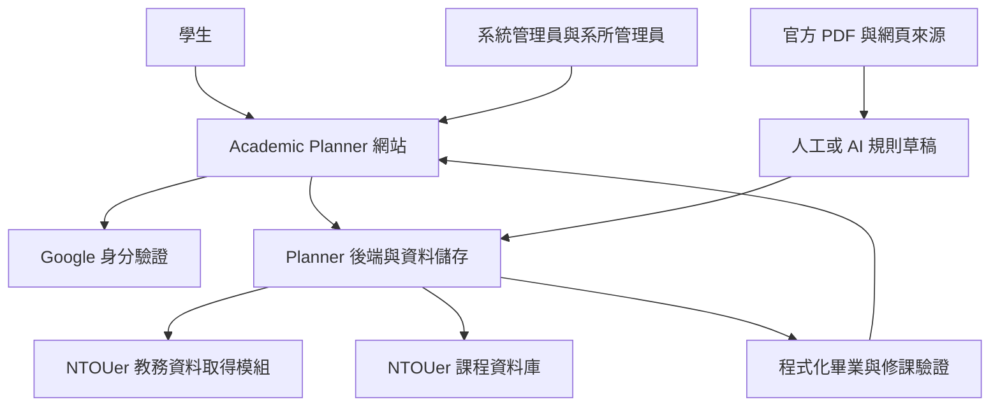

圖中 Google、教務取得模組、課程資料庫與官方來源屬外部依賴。Planner 負責個人資料、版本與檢核；維護者依權限決定草稿發布後，檢核才採用適用的已發布版本。I1 僅實作測試資料與基本檢核部分。

### 2.4 產品範圍

| 範圍 | 包含內容 |
| --- | --- |
| MVP 必要 | Google 身分、按需 AIS 同步、紀錄修正與條件覆蓋、規則檢核與三情境、課程搜尋與歷年資訊、缺額篩選、一份個人計畫、正式班別基本衝堂、人工規則建立與受控發布、官方 PDF 的 AI 規則草稿（人工確認後才發布）、管理端驗證／測試／審核／稽核。 |
| 優先擴充 | 已知先修驗證、AI 個人化建議、歷年開課頻率輔助。 |
| 進階 | 多學期最佳化、多方案比較、自動無衝堂候選課表、拖曳排課、自動讀取官方網頁、規章變更偵測、完整擋修與複雜抵免。 |
| 範圍外 | 代辦正式選課、保證未來開課、校方畢業認證、持久儲存 AIS 密碼、要求學生上傳達標證明或審核個人覆蓋。 |

首批支援 113 入學資工學生。適用規定須逐條列入覆蓋清單，標示自動檢核、學生手動設定或尚未支援；來源與目前缺口見第 8.7 節。已有條件但缺資料屬未知，可手動設定；未確認規定或未建立節點屬覆蓋缺漏，不能當作已滿足。

I1、I2、I3 的交付見第 9 節，產品 MVP 的完成條件見第 10.3 節；其他系所與年度在有適用規則後擴充。範圍表中的歷年開課頻率輔助及進階構想僅作方向登錄，尚無獨立驗收承諾；安排實作前須補齊 AP-UR、AP-US、AP-FR 與驗收依據。

### 2.5 現有資源與實作方向

目前可沿用的資源為歷年課程資料庫及教務資料取得模組，I1 已有模擬資料基本檢核 Demo；正式個人資料、規則管理與規劃功能仍待整合與實作。既有資源需測試欄位、狀態及識別碼對應，才能認定完成本專案的整合需求。

系統採獨立 Web 應用，在 Linux 環境部署。初步實作方案如下，為暫定設計方向，可依既有模組與團隊決策調整；調整時同步更新設計文件。

| 層次 | 暫定方案 | 主要職責 |
| --- | --- | --- |
| 前端 | React 與 TypeScript | 個人資料、條件、搜尋與計畫的互動頁面。 |
| 後端 | Node.js 與 TypeScript | 身分及權限、模組整合、資料保存、程式化檢核。 |
| 持久資料 | PostgreSQL | 使用者、個人修正、計畫、規則版本及來源。 |
| 教務取得 | 沿用 NTOUer 現有模組，保留其既有執行環境 | AIS 驗證與資料取得，不在 Planner 重寫完整爬取流程。 |
| 部署 | Linux 主機上的網站與後端服務，對外採 HTTPS | 提供學生與管理者存取。 |

I1 採本地測試資料與開發／預覽伺服器。教務 adapter 已有 fixture 測試與命令列示範，但尚未驗證真實 AIS 登入，也未接上畫面同步流程；這是整合準備，不視為 FR-02 正式同步已完成。實際重跑證據見報告前檢查紀錄；部署及整合階段見第 9 節。AI 模型與 PDF 解析於擴充階段選擇。

容器拆解、規則包格式、引擎演算法、發布狀態機、資料表與 API 草案見[系統設計文件](../design/system-design.md)；規則紀錄格式見[規則描述模型](../design/rule-model.md)，機器版為[規則包 schema](../design/rule-bundle.schema.json)。設計文件與本文件衝突時，以本文件的需求與驗收為準，並回頭修正設計文件。

### 2.6 名詞定義

| 名詞 | 定義 |
| --- | --- |
| 原始資料 | 從教務模組取得的修課資料快照，保留其來源及同步時間。 |
| 有效修課紀錄 | 原始資料套用個人修正、新增與排除後，實際供檢核使用的紀錄。 |
| 條件覆蓋 | 學生直接指定某項條件為已達標、未達標或尚未確認；不改變學分數。 |
| 規則集 | 對特定系所與入學年度適用的結構化畢業條件及來源。 |
| 已發布版本 | 經具發布權者提供給學生端使用的版本，可為未經系所審核。 |
| 規則草稿 | 尚未發布的版本，可供維護者預覽，不自動供學生端採用。 |
| 修課計畫 | 學生依未來學期安排的候選課程，尚非正式修課紀錄。 |

## 3 操作概念 (Operational Concepts)

### 3.1 學生首次檢視畢業進度

小宇是 113 入學的資工系學生，想知道自己還缺哪些課程。他開啟獨立網站，以 Google 登入，再輸入教務帳密進行一次資料同步。系統取得修課資料後，顯示資料時間與適用的最新已發布規則。若這份規則由系統管理員在系所無管理員時發布，頁面明確顯示「未經系所管理者審核」。

小宇先選「目前已完成」，看到總學分、必修、選修等各項條件。即使總學分達標，未完成的必修仍保留為缺額。他切換「本學期全部通過後」，系統以修課中課程假設通過重新檢核，顯示這學期結束後仍需補足的內容。

若同步失敗，系統保留前次成功資料與個人修正，告知此次未更新，讓他重試或自行補充。若沒有適用規則，系統引導檢視資料及設定，不以其他年度規則靜默代替。

### 3.2 學生補充修課資料及達標狀態

小宇發現一筆抵免紀錄未出現在資料中，便新增課程及學分，指定抵免狀態與採計方式。另一筆課程分類不符個人情況，他修改其分類。這些修改儲存於個人修正層，原始快照保留；新同步不清除修正，原始資料變更時顯示更新標記，並提供原始值比較供他確認。

英文門檻尚無可判定資料，小宇自行設定為「已達標」。系統立即更新該條件及整體結果，不要求證明；英文門檻的覆蓋不增加總學分。他可隨時取消覆蓋或恢復某筆課程的原始資料。

### 3.3 學生安排未來學期

小宇從尚缺條件開啟候選課程列表，檢視歷年開課紀錄，再將課程加入未來學期。系統儲存一份可繼續修改的計畫。他選「規劃課程全部通過後」，比較加入與移除課程後的缺額。

對已有正式課表的學期，小宇選定實際班別，系統指出同時段課程與節次。對尚未公佈課表的學期，系統顯示「開課與時間尚未驗證」，只提供歷史參考，不顯示「確定無衝堂」。

### 3.4 維護者建立與發布規則

維護者依官方文件建立草稿，記錄來源、適用年度與條文定位，使用測試紀錄預覽後，依第 8.5 節權限發布。學生端換用新版並重新檢核；圖示操作見 AP-UI-06。系所管理員加入前後的發布權、舊版標示與覆蓋遷移均依第 8.5 節。

### 3.5 Iteration 1 展示

操作者開啟 Demo，不登入 Google 或 AIS。頁面顯示「開發測試規則，僅檢核部分條件」。操作者選取模擬修課紀錄，執行總學分與分類學分檢核，檢視已取得、尚缺及條件狀態，再切換資料驗證結果變化。測試與畫面使用相同檢核邏輯。

## 4 使用者故事地圖 (User Story Map)

### 4.1 使用者操作主幹與迭代切片

[Miro 使用者故事地圖](https://miro.com/app/board/uXjVEazHH8w=/)。地圖分為學生與規則維護者，橫向為操作順序，縱向為交付階段；跨階段故事表示逐步擴充，實際完成狀態由看板記錄。規劃階段不代表已完成；例如 I1 的 US-12 僅為系統管理員維護測試規則，不是已交付規則編輯介面。修正紀錄與手動設定為需要時使用的操作；未標編號的後續能力，實作前再細化故事及驗收。

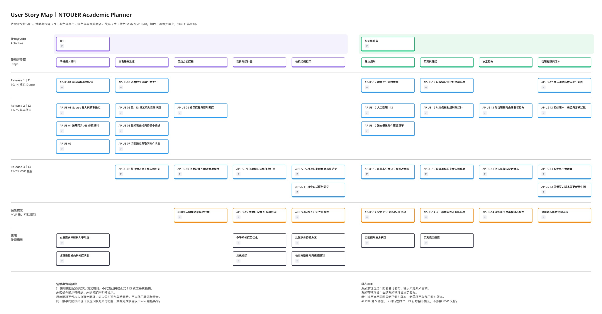

圖 4-1：團隊提供的完整故事地圖，原圖保留於[原尺寸圖片](wireframes/assets/story-map-team.jpg)。圖內 v0.3 為地圖來源版次，10/14 為原課綱 I1 日期；圖為歷史規劃快照，階段細節以本版第 4.2、6、9 節為準；學生與規則維護者的 I1、I2、I3、優先擴充及進階切片均見此圖。AP-US-06 的完整名稱與操作見第 4.3 節。範圍限制及發布政策依第 2.4、8.5、8.6、9.2 節。**v0.9 起 US-14（AI 規則草稿）由優先擴充改列 MVP（I2 試作、I3 整合）**，地圖保留原 v0.3 切片的歷史樣貌，不重繪。

### 4.2 使用者故事索引

本表提供名稱、優先級、階段與功能對應；完整角色、需求與目的見第 4.3 節。M／S／C 與 I1／I2／I3 的定義見第 1.2 節。

| 故事編號 | 名稱 | 優先與階段 | 對應功能 |
| --- | --- | --- | --- |
| AP-US-01 | 載入展示資料 | M；I1 | FR-02、FR-03 |
| AP-US-02 | 檢視畢業缺額 | M；I1 部分、I2 至 I3 完整 | FR-03、FR-04 |
| AP-US-03 | Google 登入與持續使用 | M；I2 | FR-01 |
| AP-US-04 | 同步教務資料 | M；I2 | FR-02 |
| AP-US-05 | 切換畢業進度情境 | M；I2 前兩情境、I3 完整 | FR-04 |
| AP-US-06 | 修正個人修課紀錄 | M；I2 | FR-05 |
| AP-US-07 | 手動設定條件狀態 | M；I2 | FR-06 |
| AP-US-08 | 搜尋課程及歷年開課 | M；I2 | FR-07 |
| AP-US-09 | 建立與保存學期計畫 | M；I3 | FR-08、FR-04 |
| AP-US-10 | 從缺額找到候選課程 | M；I3 | FR-09 |
| AP-US-11 | 檢查正式班別衝堂 | M；I3 | FR-10 |
| AP-US-12 | 建立與預覽畢業規則 | M；I1 測試、I2 規則資料、I3 介面 | FR-11 |
| AP-US-13 | 依系所權限發布規則 | M；I2 受控設定與基本權限發布、I3 完整系所流程 | FR-12、FR-13 |
| AP-US-14 | 解析官方 PDF 草稿 | M；I2 可行性試作、I3 完整 | FR-14、FR-11 |
| AP-US-15 | 取得個人化修課建議 | S；MVP 後 | FR-15 |
| AP-US-16 | 檢查已知先修條件 | S；MVP 後 | FR-16 |

### 4.3 使用者故事卡片

每張卡保留故事、註記與測試方法；優先與階段見第 4.2 節。詳細測試輸入與預期結果集中於第 10 節。

#### AP-US-01 載入展示資料

- **故事**：作為 Demo 操作者，我能選取模擬修課紀錄，以便展示資料如何影響檢核。
- **註記**：展示使用匿名化或模擬資料，與正式個人帳戶資料分開；切換樣本後須重新檢核，不在頁面硬寫答案。
- **測試方法**：載入 A、B、C 及格樣本，確認總學分 9、選修缺 3（TC-01）；載入空資料，確認顯示零學分及完整差額且不報錯（TC-04）。

#### AP-US-02 檢視畢業缺額

- **故事**：作為學生，我能查看每項畢業條件的結果與尚缺內容，以便知道需要補足哪些條件。
- **註記**：總學分、分類學分與指定必修須分開檢查；未建模或未知條件須保留範圍與狀態，不以已知條件全部通過代替完整結果。
- **測試方法**：驗證門檻不足、等於及超過的採計數與差額（TC-01 至 TC-03）；驗證總學分達標但指定必修缺漏時仍未完成（TC-25）；檢查覆蓋清單（TC-26）。

#### AP-US-03 Google 登入與持續使用

- **故事**：作為學生，我能以 Google 登入並讀取個人設定，以便持續修改修課規劃。
- **註記**：Google 身分為持久帳戶，不等同 AIS 登入；每名使用者僅能存取自己的資料；登入失敗不建立可存取的個人工作階段。
- **測試方法**：同一身分重新登入可讀取該階段已保存資料，I2 驗證設定與修正，I3 再驗證計畫；他人讀寫請求被拒絕（TC-13）；登入失敗及登出後個人 API 不再允許存取（TC-13）。

#### AP-US-04 同步教務資料

- **故事**：作為學生，我能按需取得教務修課資料，以便減少手動整理。
- **註記**：沿用現有取得模組，不長期保存 AIS 密碼；失敗保留前次成功資料；未知狀態不得當成及格；系所及入學年度優先使用取得的資料；缺少時由學生補充並顯示採用值。
- **測試方法**：同步成功後顯示快照時間；失敗不清空前次紀錄（TC-12）；檢查同步時個人修正仍保留，並依 NFR-04 檢查帳密未進入持久儲存及日誌。

#### AP-US-05 切換畢業進度情境

- **故事**：作為學生，我能切換目前、修課中及計畫通過的假設，以便比較各階段剩餘需求。
- **註記**：三種情境使用同一規則版本與檢核邏輯；假設通過不改寫實際紀錄；所有受影響條件均重新計算。
- **測試方法**：A、B 已及格、C 修課中、D 在計畫，三情境總學分應為 6、9、12（TC-09）；確認分類結果同步更新，原始修課狀態不變（TC-09）。

#### AP-US-06 修正個人修課紀錄

- **故事**：作為學生，我能補充、修改、排除或恢復個人紀錄，以便反映自己的實際修課情況。
- **註記**：修正保存於個人層，不覆寫原始快照；允許零學分的合法免修情況；負學分及非法狀態拒絕保存；MVP 保留修正並提供原始值比較，不要求完整自動衝突解決介面。
- **測試方法**：將 3 學分改為 2，保存及重新登入後依 2 採計；恢復後依 3 採計（TC-11）；新同步不移除修正；無法對應的修正標示待處理（TC-12）。

#### AP-US-07 手動設定條件狀態

- **故事**：作為學生，我能設定及取消畢業條件的完成狀態，以便處理無法從教務取得的資訊。
- **註記**：不需證明或管理員審核，個人設定直接參與計算；條件覆蓋不增加學分；上層組合與整體結果依有效狀態重新計算。
- **測試方法**：英文未知改達標，再清除，依序得到達標及未知，總學分不變（TC-10）；子條件覆蓋後驗證上層 AND／OR 及整體結果同步更新（TC-24）。

#### AP-US-08 搜尋課程及歷年開課

- **故事**：作為學生，我能依名稱或代碼查詢課程，以便找到可規劃的修課選項。
- **註記**：歷年開課僅為參考，不代表未來確定開課；缺漏欄位與空結果明確顯示。
- **測試方法**：以已知名稱或代碼查到對應課程與歷史資料，無結果時顯示空狀態（TC-16）；依 NFR-10 驗證搜尋結果頁的完整呈現時間。

#### AP-US-09 建立與保存學期計畫

- **故事**：作為學生，我能按學期加入、移動及移除課程，以便模擬並持續調整未來安排。
- **註記**：每人先保存一份目前計畫，不要求多方案與拖曳課表；重複加入不重複採計；寫入失敗保留未存內容並顯示失敗。
- **測試方法**：增刪課程後重新檢核規劃情境（TC-09），重新登入可取得最後保存版本（TC-13）；模擬保存失敗，確認可重試且未假稱成功（TC-23）。

#### AP-US-10 從缺額找到候選課程

- **故事**：作為學生，我能依未完成條件篩選課程，以便縮小搜尋範圍。
- **註記**：候選須有已知採計對應；未知分類不保證能填補缺額；選入計畫後仍須重新檢核，列表不保證開課或選課資格。
- **測試方法**：設定指定必修或分類缺額，檢查候選對應與加入後結果（TC-16）。

#### AP-US-11 檢查正式班別衝堂

- **故事**：作為學生，我能看到已知正式班別的時間重疊，以便調整學期計畫。
- **註記**：同學期、星期、節次與已知週次共同判斷；缺班別、缺時間或未公布開課時標示未驗證。
- **測試方法**：同節次且週次重疊的正式班別列出衝堂（TC-17）；未公布學期顯示未驗證，不顯示已確認無衝堂（TC-17）。

#### AP-US-12 建立與預覽畢業規則

- **故事**：作為規則維護者，我能依官方來源建立結構化條件並預覽，以便提供可追溯的檢核規則。
- **註記**：記錄適用系所、入學年度、來源與定位；I2 可先採受控結構化資料維護；I3 完成基本表單，不要求視覺化規則設計器；113 規則須有覆蓋清單，未知來源不假稱已核對。
- **測試方法**：修改測試門檻後檢核結果改變，非法結構不形成可執行版本（FR-11 驗收）；檢查測試用途與部分範圍（TC-08）、113 覆蓋清單（TC-26）。

#### AP-US-13 依系所權限發布規則

- **故事**：作為發布者，我能發布可供學生採用的規則版本，以便控制適用規則與其來源狀態。
- **註記**：無管理員由系統管理員發布；有管理員由該系所管理員決定發布；學生使用適用範圍最新已發布版，草稿不取代現行版本；管理員可先以受控後端設定指派，不另建完整帳戶管理平台。
- **測試方法**：驗證無管理員、有管理員及跨系所發布權限（TC-18）；加入管理員後舊版維持原標示，新版發布才取代舊版（TC-19）；覆蓋處理依 TC-20。

#### AP-US-14 解析官方 PDF 草稿

- **故事**：作為規則維護者，我能取得可編輯的 AI 結構化草稿，以便減少人工轉錄。
- **註記**：解析不等於發布；結構或來源缺漏須提示；AI 草稿是 MVP 的草稿來源之一，但人工撰寫仍須能走完同一流程；不承諾任意掃描 PDF 皆可解析，解析不出來時回退人工編輯，不得因此卡住規則維護。
- **測試方法**：合法輸出供編輯，非法或缺漏輸出指出問題；AI 草稿與人工草稿共用同一驗證、測試、審核與發布流程；學生版本不自動更換（TC-21）。

#### AP-US-15 取得個人化修課建議

- **故事**：作為學生，我能根據偏好取得候選計畫與理由，以便比較適合自己的安排。
- **註記**：建議須接受程式化驗證，不由 AI 認定畢業或全部可行；未經學生選取不得覆寫已存計畫。
- **測試方法**：不存在課程或已知限制違反時指出問題；未知限制明示，原計畫保留（TC-22）。

#### AP-US-16 檢查已知先修條件

- **故事**：作為學生，我能了解候選課程的先修檢核結果，以便知道已知選課限制。
- **註記**：缺資料為未驗證，不等於沒有先修；同學期修習僅在規則明訂可並修時算滿足。
- **測試方法**：未滿已知先修時列出缺少課程；無資料時顯示未驗證（TC-22）。

## 5 使用者介面分析 (User Interface Analysis)

以下七節整合用途、核心控制項、線稿與操作結果。圖為匿名資料的低擬真需求示意；開發測試數值依第 10.1 節，覆蓋圖另使用完整合成測試規則。正式門檻見第 8.7 節。圖號沿用 v0.4，以保持既有引用一致。

### 5.1 AP-UI-01 登入與資料同步

提供 Google 登入、教務資料同步、最後成功同步時間及資料來源。AIS 帳密只在需要同步時顯示；同步中顯示進度，失敗提供重試及手動補充。缺少適用規則時提示缺少規則，不改套其他年度。

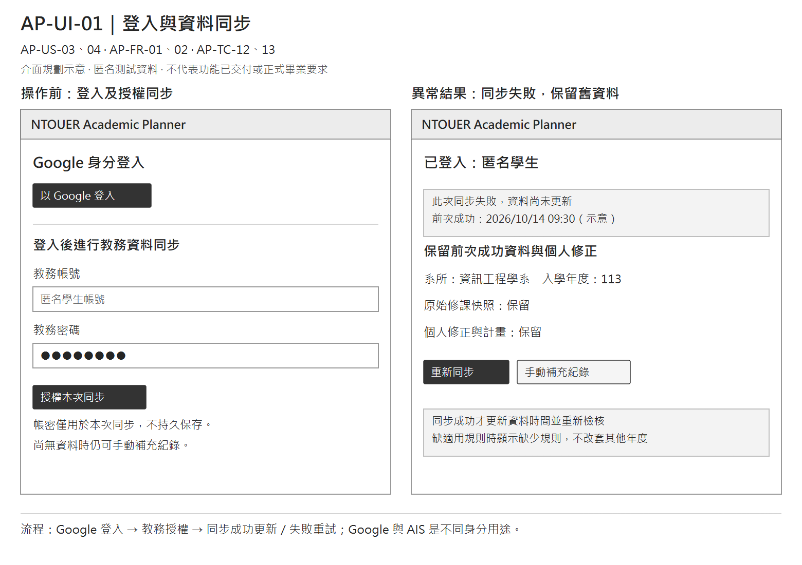

**操作結果**：圖示失敗分支：此次未更新，保留前次快照、修正與計畫；成功才更新快照時間並重新檢核。首次尚無資料時不得虛構前次快照。

**對應**：操作概念 3.1；US-03、04；FR-01、02；TC-12、13。

### 5.2 AP-UI-02 畢業進度首頁

依序顯示系所、入學年度、規則版本及審核狀態、資料時間、情境切換、總學分與條件清單。切換名稱為「目前已完成」、「本學期全部通過後」、「規劃課程全部通過後」。總學分呈現「可採計學分／門檻，尚缺學分」，百分比只稱總學分進度。條件以文字搭配色彩表示，詳情可查看採計課程、差額與來源；整體訊息依第 8.4 節。

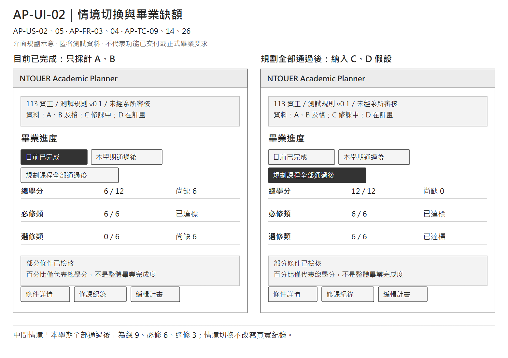

**操作結果**：A、B 已及格，C 修課中，D 在計畫：三情境總學分為 6、9、12，必修皆 6，選修為 0、3、6。圖示第一與第三情境；切換更新同一結果區，不改寫真實狀態。

**對應**：操作概念 3.1；US-02、05；FR-03、04；TC-09、14、26。

### 5.3 AP-UI-03 條件詳情與手動設定

顯示條件描述、來源、門檻、採計與未採計課程及原因、系統原判斷與有效結果。提供「已達標、未達標、尚未確認」及「恢復系統判斷」。儲存後更新條件與整體結果；非學分條件不顯示虛構學分，覆蓋順序依第 8.3 節。

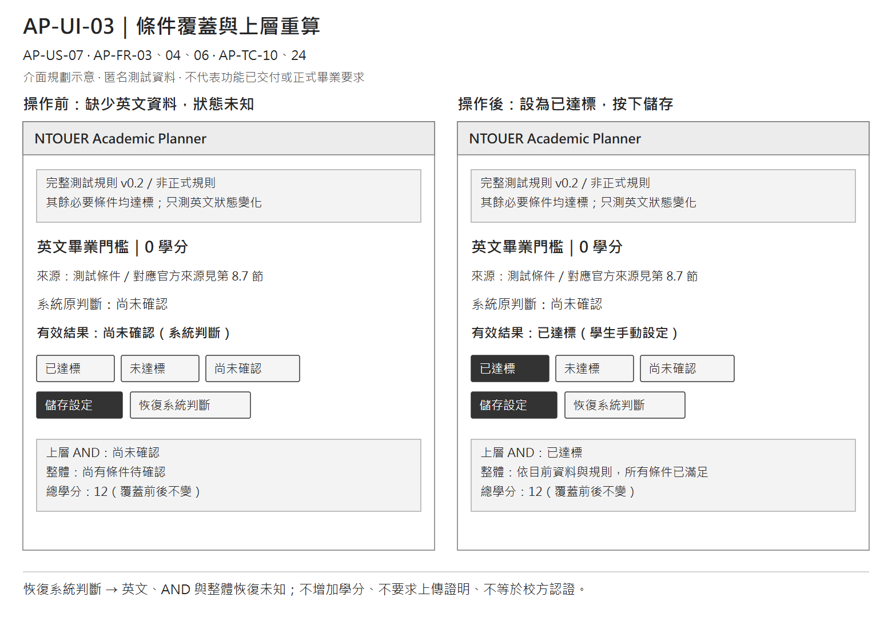

**操作結果**：完整合成測試規則、其餘必要條件已達標：英文未知 → 設達標並儲存 → AND 與整體達標；恢復系統判斷後均回到未知，總學分維持 12。部分規則仍依第 8.4 節顯示範圍限制。

**對應**：操作概念 3.2；US-07；FR-03、04、06；TC-10、24。

### 5.4 AP-UI-04 修課紀錄

列出課程代碼、名稱、學期、學分、分類、狀態、採計設定及來源。支援新增、修正、排除及恢復；原始與有效值可比較，排除不刪除 AIS 快照。非法值指出欄位與原因。

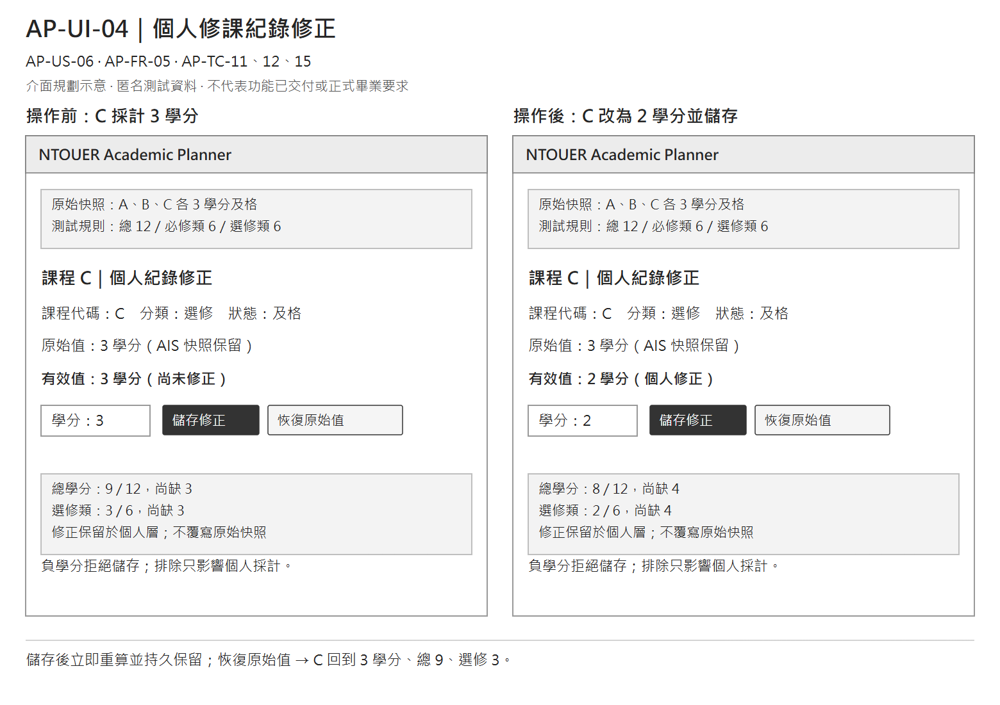

**操作結果**：C 由 3 改為 2 學分並儲存：總 9→8、選修 3→2，原始值仍為 3；恢復後回到總 9、選修 3。修正跨登入保留，負學分不保存。

**對應**：操作概念 3.2；US-06；FR-05；TC-11、12、15。

### 5.5 AP-UI-05 課程搜尋與學期規劃

支援課名、代碼、分類及缺額篩選，詳情提供歷年開課；無符合資料顯示空結果。以學期分組列表安排課程，支援學期選擇、新增學期、加入、移動、移除與保存；不要求拖曳課表。桌面可並列搜尋與計畫，手機依序呈現。正式課表可選班別，衝堂列出課程、星期及節次；保存狀態及衝堂結果位於計畫區。未知開課、時間與先修分別標示，驗證限制依第 8.6 節。

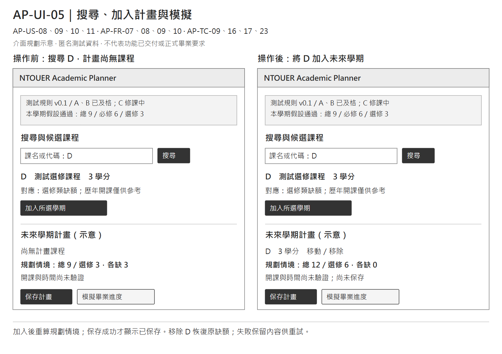

**操作結果**：A、B 已及格、C 修課中：加入 D 前規劃情境總 9／選修 3，加入後 12／6；移除 D 恢復缺額。保存成功才顯示已保存，失敗保留編輯供重試；加入後重算所有條件。

**對應**：操作概念 3.3；US-08、09、10、11；FR-07、08、09、10；TC-09、16、17、23。

### 5.6 AP-UI-06 規則管理

提供系所與年度選擇、來源登錄、條件名稱／類型／門檻／採計課程／必要性編輯、草稿預覽與版本列表。顯示發布者、時間、審核標示及影響範圍。發布按鈕依權限顯示，後端仍須驗證；完整政策見第 8.5 節。AI PDF 草稿入口為 MVP 功能（FR-14），初稿一律進入草稿狀態並標示來源。

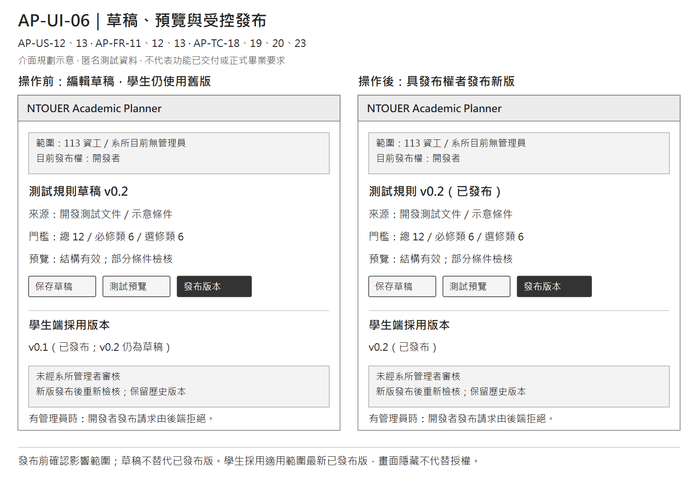

**操作結果**：編輯草稿時學生仍採現行發布版；具權限者發布成功後才換版並重算，保留舊版本與原審核標示。圖以無管理員、系統管理員發布的分支示意。

**對應**：操作概念 3.4；US-12、13；FR-11、12、13；TC-18、19、20、23。

### 5.7 AP-UI-07 Iteration 1 Demo

提供規則說明、預設模擬資料選取、執行檢核與結果區。I1 不要求資料匯入、任意輸入或編輯介面。至少顯示總學分、兩類學分的已完成及缺額，持續標示測試用途與部分檢核。交付界線依第 9.2 節。

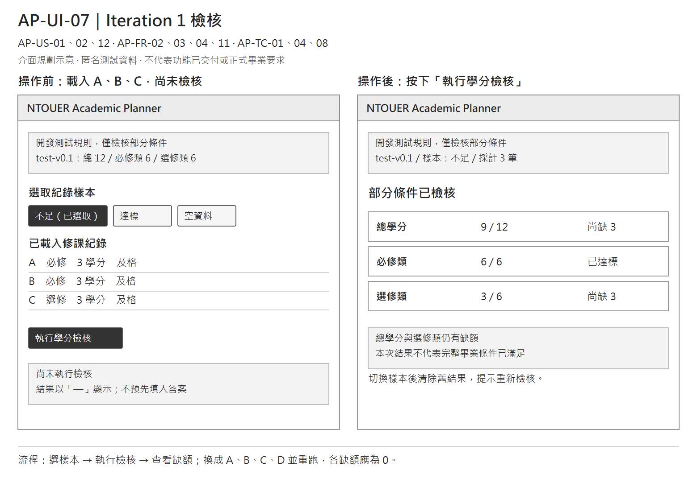

**操作結果**：載入 A、B、C 及格後執行：總 9 缺 3、必修 6 缺 0、選修 3 缺 3。切換樣本清除舊結果並提示重跑；A、B、C、D 皆及格時三項缺額均為 0。

**對應**：操作概念 3.5；US-01、02、12 的 I1 子集；FR-02、03、04、11；TC-01、04、08。

### 5.8 AP-UI-08 規則驗證與測試

提供兩個獨立關卡：結構驗證（條文參照、來源雜湊、selector 語法、池與優先序參照）與測試案例（採計上限、重複採計、抵免／免修、例外衝突）。錯誤須指出條文、節點或欄位，不得只顯示「無法解析」；未通過不得送審。

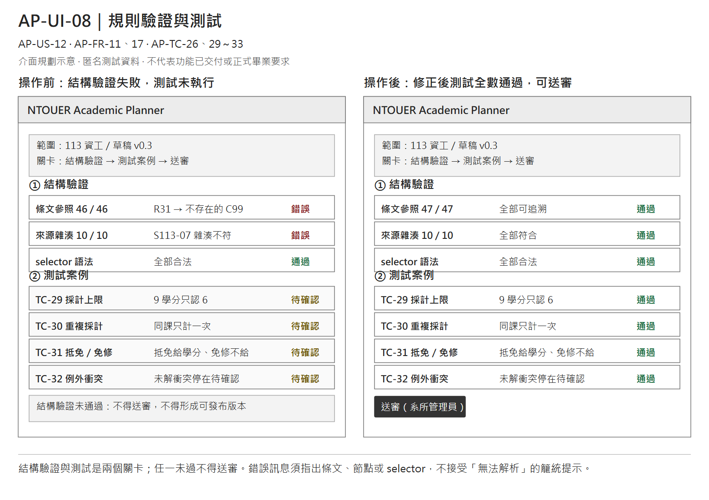

**操作結果**：驗證失敗時列出 3 個錯誤（R31 指向不存在的 C99、來源雜湊不符、selector 合法），測試案例維持「待確認」且無送審按鈕；修正後結構與測試全綠，才出現「送審」。

**對應**：US-12；FR-11、FR-17；TC-26、29～33。

### 5.9 AP-UI-09 審核與差異

提供版本間差異摘要（新增／變更／刪除／不變）、審核意見輸入、核准與退回。差異由結構比較產生，不靠 AI 判讀語意；核准前後端重驗權限與內容雜湊；代理發布須標示未經系所審核。

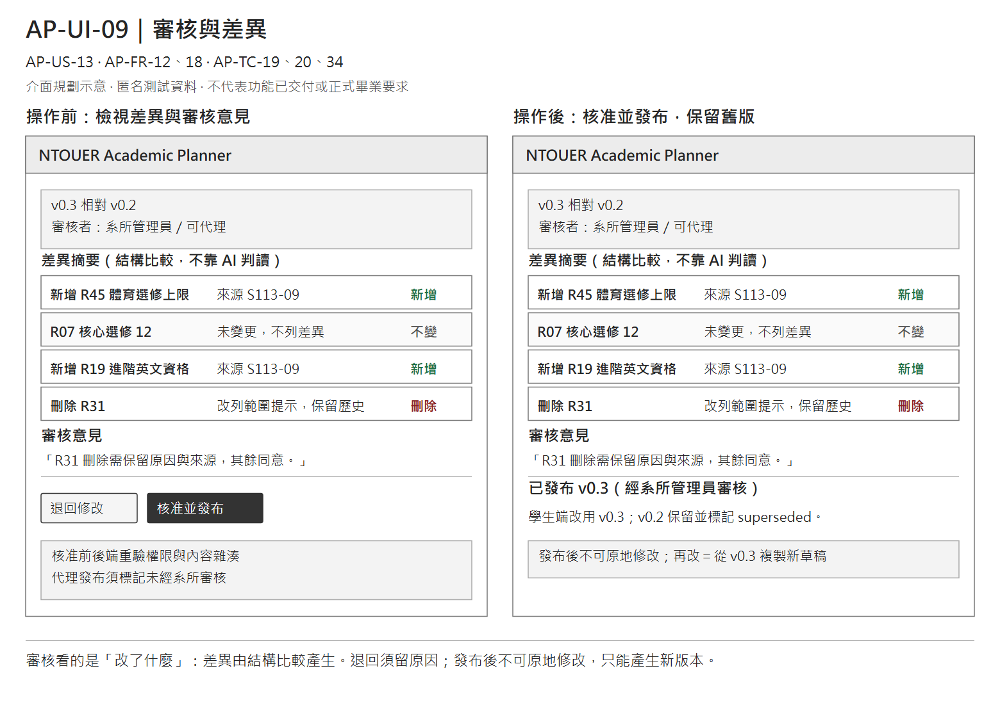

**操作結果**：核准前可看到「新增 R45、新增 R19、刪除 R31」與審核意見；核准後顯示已發布 v0.3、學生端改用 v0.3、v0.2 標記 superseded，且提示發布後不可原地修改。

**對應**：US-13；FR-12、FR-18；TC-19、20、34。

### 5.10 AP-UI-10 稽核紀錄與追溯

以版本時間軸呈現 created、validated、tested、submitted、approved、published，每一步保留操作者、角色、系所範圍、時間與內容雜湊。紀錄唯讀，不隨版本刪除；學生端結果可回查到版本與條文定位。

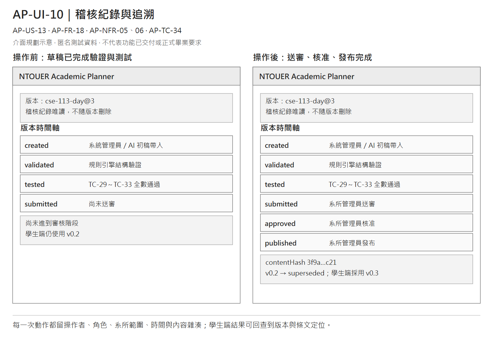

**操作結果**：草稿階段停在 tested（尚未送審），學生端仍用 v0.2；完成送審、核准、發布後時間軸出現後三步，顯示 contentHash 與 v0.2 已 superseded。

**對應**：US-13；FR-18；NFR-05、06；TC-34。

### 5.11 AP-UI-11 系所管理員指派

列出各系所與目前管理員狀態（已指派／代理），提供以 Google 身分指派與撤銷。指派只授予該系所；撤銷最後一位後恢復由系統管理員發布；歷史審核標示不改寫。

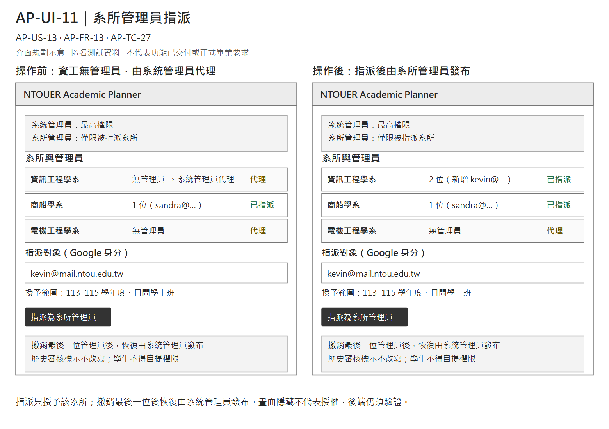

**操作結果**：指派前資工顯示「無管理員 → 系統管理員代理」；指派後顯示 2 位管理員並改由系所管理員發布，代理標示消失。

**對應**：US-13；FR-13；TC-27。

十一張介面線稿（學生端 7 張、管理端 4 張）的可編輯 SVG 集中於[需求圖庫](wireframes/index.html)，不在每節重複列下載資訊。

## 6 功能需求 (Functional Requirements)

### AP-FR-01 Google 持久身分與個人存取

優先：M；階段：I2。系統應讓學生、系統管理員及系所管理員以 Google 身分登入。後端應驗證登入身分與資料歸屬，以儲存與讀取各階段已交付的個人設定、修正及計畫；沿用 NTOUer 可用的驗證模組，不要求先進入主 App。

驗收：I2 同一 Google 身分再次登入可取得已保存的個人設定與修正；使用者 A 無法藉修改請求識別碼讀寫 B 的紀錄；登入失敗不建立有效工作階段，登出後無法繼續存取需登入的個人 API。I3 計畫保存交付後，再依 FR-08 驗證跨登入讀取原計畫。

### AP-FR-02 教務同步與模擬資料載入

優先：M；階段：I1 模擬、I2 同步。系統應沿用既有模組按需取得學籍與修課資料，保留原始快照及成功同步時間，對應可取得的修課狀態。帳密只用於此次授權同步，需重新驗證時再次輸入；未知欄位或狀態不得猜測為及格。系所與入學年度優先使用取得的資料，缺漏時由學生補充；MVP 僅對 113 資工適用規則進行學生端實際檢核，其他範圍顯示尚未支援。

驗收：I1 能載入指定模擬資料；I2 成功同步更新快照、顯示成功同步時間並保留個人修正；失敗保留前次成功資料並告知未更新；不在資料庫、日誌或瀏覽器持久儲存中保留 AIS 密碼。

### AP-FR-03 畢業規則檢核

優先：M；階段：I1 基本學分、I2 至 I3 完整 MVP。系統應以程式規則對有效紀錄計算總學分、分類學分、指定必修、課程群組及非學分條件，輸出門檻、採計內容、缺額與三態結果。規則模型、去重及範圍依第 8 節。

驗收：I1 正確處理門檻不足、等於與超過、無紀錄、不及格排除、可識別的重複資料；後續完整版本在總學分足夠但必修缺漏時仍顯示缺漏。未知或未支援的必要條件不能導致完整達標結果。

### AP-FR-04 三種進度情境與整體結果

優先：M；階段：I1 已完成、I2 修課中、I3 全整合。系統應對三情境重新執行同一檢核邏輯，保持實際與假設資料分開，並顯示該情境及範圍。「目前已完成」僅採已完成且可採計的紀錄；「本學期全部通過後」再加入本學期修課中的通過假設；「規劃課程全部通過後」則在第二情境上再加入計畫課程的通過假設，並依第 8.2 節去重。無修課中或計畫課程時，該情境與前一情境一致；不保證新增任意課程都能增加學分。整體結果依第 8.4 節。

驗收：切換情境會同步改變總學分及相關必修、分類與群組結果；修課中與計畫課程不加入「目前已完成」；不因模擬而改寫真實修課狀態。

### AP-FR-05 個人修課紀錄修正

優先：M；階段：I2。系統應允許學生新增缺漏紀錄、修正學分、分類與狀態、指定採計關係或排除紀錄。原始快照、個人修正與合併後有效資料分開；使用者可恢復原始值或刪除個人新增項目。

驗收：有效修正立即重算並在再次登入後保留；恢復後按原始值重算；負學分或非法狀態拒絕儲存。新同步不靜默清除修正；原始值更新時顯示更新標記並提供原始值與有效值比較。無法匹配的舊修正保留並標示需重新對應，不轉成另一門課；MVP 不要求自動合併複雜衝突。

### AP-FR-06 個別畢業條件覆蓋

優先：M；階段：I2。系統應允許學生設定已達標、未達標或尚未確認，以及清除覆蓋恢復自動結果。覆蓋優先於自動判斷，不需上傳證明或管理員審核；保留來源供本人瞭解。

驗收：未知條件設為已達標後參與整體計算；設為尚未確認後維持未知；清除後恢復原自動結果。覆蓋某學分條件的狀態不憑空增加可採計學分，也不取消其他獨立條件的缺額；上層組合與整體結果須以有效狀態重新計算。

### AP-FR-07 課程及歷年開課查詢

優先：M；階段：I2。系統應查詢 NTOUer 現有資料庫，支援名稱與代碼搜尋，顯示可取得的學分、分類、系所、歷年學期及班別資料。課程、開課紀錄與班別應分開識別。

驗收：已知名稱或代碼回傳對應資料；無結果顯示空狀態；歷史紀錄不標示為未來已確認開課。欄位缺失明示，不產生假資料。

### AP-FR-08 基本修課計畫與儲存

優先：M；階段：I3。系統應為每名學生儲存一份目前計畫，支援建立學期、加入、移動及移除課程，並將其納入規劃情境。計畫課程可引用課程資料；已有正式班別時可指定班別。

驗收：增刪後缺額重新計算；重新登入可讀取最後成功儲存版本；同一學期重複加入同課程應提示並避免重複採計；儲存失敗顯示失敗且保留編輯內容。

### AP-FR-09 依畢業缺額篩選課程

優先：M；階段：I3。系統應根據尚缺的分類、指定課程或群組，提供符合已建模採計規則的候選課程及對應條件。分類未知或無法對應者不得宣稱必定填補缺額。

驗收：指定測試缺額僅回傳可對應的候選課程；學生加入候選課程後重新檢核，顯示實際影響。推薦列表本身不保證正式開課、無衝堂或選課資格。

### AP-FR-10 正式課表時間衝堂檢查

優先：M；階段：I3。系統應對同學期正式班別的完整上課時間進行重疊檢查，以星期、節次及可取得的教學週次判斷衝堂。缺時間或缺班別者顯示未驗證；未公佈課表的學期僅供歷史參考。

驗收：同星期同節次且適用週次重疊的班別被標示，並列明雙方課程與節次；已知週次不重疊者不列為衝堂；週次規律不足時標示可能衝堂／待確認，不宣稱無衝堂。

### AP-FR-11 結構化規則與來源建立

優先：M；階段：I1 測試資料模型、I2 正式規則資料、I3 基本編輯介面。系統應支援官方 PDF、官方網頁與人工輸入來源，儲存來源名稱、URL 或文件識別、適用年度、頁碼或條文定位、規則描述與結構化條件。人工輸入代表整理方式，仍須對應來源或清楚標示來源未補齊。

驗收：I2 完成受控結構化規則資料及 113 覆蓋清單；I3 維護者可透過基本介面建立與修改有效草稿、以測試紀錄預覽；錯誤欄位或未支援運算子顯示原因，不能形成可執行版本；I1 測試規則清楚標示，數值不視為正式 113 規則。

### AP-FR-12 系所發布權限與版本管理

優先：M；階段：I2 基本權限與發布、I3 完整系所流程。系統應依第 8.5 節檢查發布權，儲存發布者、時間、版本、適用範圍及審核標示。發布版本形成不可原地覆寫的歷史快照，修改需建立新版本。

驗收：無管理員的系所由系統管理員發布，標示未經系所審核；有管理員時系統管理員發布請求被後端拒絕，該系所管理員可發布；其他系所管理員不可發布。草稿不取代學生版本，更新後重新檢核。

### AP-FR-13 系所管理員指派

優先：M；階段：I2 受控設定、I3 完整流程整合。系統應讓系統管理員設定與移除各系所的管理員 Google 身分，可透過受控後端設定完成，不要求獨立完整管理平台。發布時以當下有效管理員設定驗證權限。

驗收：一般學生無法變更管理員；指派只授予對應系所權限；管理員加入後舊系統管理員版本保持原標示；若全部管理員移除，該系所恢復由系統管理員發布，舊版本不改寫。I2 即以受控後端設定驗證上述生命週期及發布權限（TC-27），不等到 I3 才開始驗證權限。

### AP-FR-14 官方 PDF 的 AI 規則草稿

優先：M；階段：I2 可行性試作、I3 完整。系統應將官方 PDF 的可讀內容交由 AI 解析為可編輯結構化草稿，保留原文定位，並驗證資料結構與運算子是否可執行。解析完成不等於發布；AI 草稿與人工草稿進入同一條驗證、測試、審核與發布流程。

驗收：草稿包含來源定位與需確認項目；結構不合法、內容缺漏或解析失敗時告知並允許人工編輯；學生端仍使用既有已發布版本。草稿由當下具發布權者決定發布，未經系所審核的系統管理員版本仍可使用。AI 服務不可用或解析品質不足時，人工草稿必須能走完同一流程，且不阻擋當週發布；草稿須標示來源為「AI 初稿」或「人工」，並保留 AI 輸出的原文定位供審核對照。

### AP-FR-15 AI 個人化修課建議

優先：S；階段：MVP 後。系統應接收每學期學分範圍、預計畢業學期、優先必修、交換或實習學期、偏好與避免領域，產生候選計畫、理由及取捨。學生確認加入計畫前，程式化模組檢查可取得的畢業、先修、開課及衝堂條件。

驗收：AI 不存在的課程或違反已知條件時，被指出並不標示完全可行；未知條件逐項揭露；AI 失敗不影響人工計畫；未經學生選取不自動覆寫已存計畫。

### AP-FR-16 已知先修條件驗證

優先：S；階段：MVP 後。系統應依已建立的先修資料檢查各課程；跨學期計畫以先前學期通過假設判定，只有明訂可並修時才能以同學期滿足。

驗收：已知先修未滿足時顯示課程與缺少條件；無先修資料顯示未驗證，而非沒有先修；人工設定或規劃假設的依據明確顯示。

### AP-FR-17 跨系所適用的規則描述格式

優先：M；階段：I2。系統應以同一份規則包格式描述不同系所與入學年度的畢業規則，包含來源、條文卡、條件節點、採計池、優先序、採計上限與衝突；新增系所不得修改引擎程式碼。格式須同時提供人類可讀欄位（原文、定位、白話說明）與機器可檢核欄位。

驗收：I2 以至少三個結構差異明顯的系所樣本驗證格式（資工 113、商船 115、另一含跨類上限的系所），三份都能通過結構驗證並由同一引擎算出結果；缺少條文參照、selector 格式錯誤或池參照不存在時，不得形成可發布版本；已知無法表達的規則（例如學年課上下學期連動、雙主修身分）須列為限制並顯示待確認，不得靜默忽略。

### AP-FR-18 發布稽核與來源追溯

優先：M；階段：I2。系統應為每次建立、驗證、測試、送審、核准、退回、發布與取代記錄操作者、角色、系所範圍、時間、內容雜湊與變更摘要；每一條已發布條件都必須可回查來源文件、頁碼或條號定位。已發布版本與其稽核紀錄不得被刪除或改寫。

驗收：任一學生端結果可追到規則版本與全部必要條文的來源定位；管理端可看到版本時間軸與相對前一版的差異；跨系所的操作被拒絕且留下紀錄；系統管理員代理發布時明確標示未經系所審核；查不到來源定位的條件不得進入已發布版本。

## 7 非功能需求 (Non-functional Requirements)

以下為本版工程驗收目標，不代表已測得的系統能力。效能測試須記錄 CPU、記憶體、資料量與測試工具，外部 AIS、Google 與 AI 等待時間另行記錄。

| 編號 | 品質要求 | 可驗證條件及階段 |
| --- | --- | --- |
| AP-NFR-01 正確性 | 相同規則版本、有效紀錄、覆蓋及情境得到相同結果；不得重複採計或把未知當達標。 | I1 起；依各階段已交付範圍執行第 10 節相關測試，對應案例均通過；S 功能僅在實作後驗收；結果列出採計依據。 |
| AP-NFR-02 互動與效能 | 已載入資料的個人檢核與結果重新整理，至少 95% 操作從按下檢核或送出有效修改，到完整結果顯示在畫面，在 1 秒內完成。 | I1：正式建置預覽、三項測試條件，輪流選取七組樣本共執行 100 次檢核；測至結果文字與數值更新並完成瀏覽器繪製機會。I3：每人最多 300 筆紀錄、200 項條件及 100 筆計畫，單人連續 100 次。均包含本次檢核所需請求及畫面更新，排除 Google、AIS 與 AI 等待；記錄瀏覽器、CPU、記憶體、資料量與成功比例。 |
| AP-NFR-03 基本負載 | 在初期 20 名同時活躍使用者的測試下，個人讀取、儲存及檢核從後端收到請求到完成回應的 p95 時間不超過 2 秒，伺服器錯誤率低於 1%。 | I3；每人每 5 秒一請求、讀取 50%、檢核 30%、儲存 20%，持續 5 分鐘；不含外部服務。 |
| AP-NFR-04 身分與資料安全 | 上線傳輸採 HTTPS；驗證個人資料歸屬與系所權限；AIS 密碼不持久儲存，不進日誌。 | I2 至 I3；跨使用者與跨系所請求被拒絕；檢查儲存、日誌與錯誤回應無帳密；個資儲存限授權服務存取。 |
| AP-NFR-05 可追溯性 | 每次結果識別規則版本、情境與資料時間；每條規則保留來源定位；個人修改可回復。 | I1：規則版本、測試來源、樣本名稱、採計與排除紀錄及部分範圍可辨識；固定模擬資料不虛構 AIS 同步時間。I2 至 I3：再驗證個人快照時間、情境、正式來源定位與可恢復修正。 |
| AP-NFR-06 規則與 AI 誠實呈現 | 清楚標示未經系所審核、測試用途、部分範圍及未驗證限制；AI 不繞過引擎。 | I1 起；檢查所有結果頁，未知正式開課不出現「已確認無衝堂」；解析不自動發布。 |
| AP-NFR-07 可用性與相容性 | 手機及電腦可操作；狀態不只依色彩；重要操作可用鍵盤完成。 | I3；390×844 與 1366×768，在驗收時 Chrome 與 Edge 穩定版檢查；核心表單與結果無頁面橫向溢位，寬表可局部捲動。 |
| AP-NFR-08 儲存可靠性 | 原始資料、個人修正、計畫與發布版本可持久儲存；失敗不假稱成功。 | I2 至 I3；服務重新啟動後仍可讀取已存內容；模擬寫入失敗顯示重試；發布寫入具原子性。 |
| AP-NFR-09 可維護與可測試 | 規則計算可脫離 UI 執行；UI 與測試共用檢核邏輯；規則值不硬寫在頁面。 | I1 起；更換測試門檻無需修改 UI；自動測試以同一引擎執行。 |
| AP-NFR-10 課程搜尋 | 從送出關鍵字，到完整顯示結果第一頁或無結果狀態，至少 95% 搜尋在 3 秒內完成。 | I3 驗收；以當次資料庫完整快照及每頁 20 筆測試，記錄課程筆數；10 名同時使用者各執行 20 次已知名稱、代碼及無結果查詢，涵蓋前後端。 |

## 8 資料語意與業務規則

### 8.1 最低資料模型

| 資料實體 | 必要內容 |
| --- | --- |
| 使用者與系所授權 | 內部使用者 ID、Google 身分識別、角色、可管理系所；角色由後端決定。 |
| 原始修課紀錄 | 來源紀錄鍵、課程代碼及名稱、學期、原始狀態、學分、分類、可取得的成績與採計資訊、快照與同步時間。 |
| 個人修正 | 使用者 ID、對應紀錄或個人新增 ID、修改欄位、排除設定、更新時間；保留恢復入口。 |
| 規則版本 | 系所、適用入學年度、版本及發布順序、草稿／已發布、來源、完整度、發布者與時間、審核標示。 |
| 來源與條文卡 | 來源識別、文件名稱、URL 或檔案、頁碼或條號定位、雜湊；條文原文、白話說明與核對狀態。每條必要條件至少對應一張條文卡。 |
| 條件節點 | 穩定條件 ID、描述、型別、門檻、課程集合或分類、AND／OR 關係、來源定位及是否必要。 |
| 採計配置 | 學分池、池下限與上限、單課上限、同課歸屬優先序、跨類上限。同一門課只計入一個池；子集合以不消耗額度的方式另計。 |
| 稽核紀錄與測試證據 | 版本、動作、操作者與角色、系所範圍、時間、內容雜湊、變更摘要；測試套件、通過與失敗項目。發布後不得刪除或改寫。 |
| 條件覆蓋 | 使用者 ID、規則適用範圍與穩定條件 ID、手動狀態或無覆蓋、更新時間。 |
| 課程與班別 | 課程識別、歷年學期、正式班別識別、星期節次、可取得週次、資料來源與公佈狀態。 |
| 個人計畫與結果 | 計畫學期及課程／班別引用；結果儲存版本、情境、有效資料依據、條件狀態及缺額。 |

規則應支援總學分、分類最低學分、指定課程完成、群組學分或門數、必要條件 AND、替代條件 OR 及非學分門檻。複雜例外若尚未支援，明示待確認並允許個人修正，不推測官方處理方式。

### 8.2 修課狀態與採計

| 狀態 | 目前已完成 | 修課中通過情境 | 規劃通過情境 |
| --- | --- | --- | --- |
| 已及格且可採計 | 依規則納入 | 納入 | 納入 |
| 不及格、退選或明確不採計 | 不納入 | 不因情境改為及格 | 不納入原紀錄；可另規劃重修 |
| 修課中 | 不納入已取得 | 假設通過後納入 | 假設通過後納入 |
| 未來計畫 | 不納入 | 不納入 | 假設通過後納入 |
| 抵免 | 依明確資料與規則；不明者待確認 | 同左 | 同左 |
| 免修 | 可滿足指定條件；學分是否增加依規則，不預設有學分 | 同左 | 同左 |
| 未知或無法對應 | 不預設納入，受影響條件待確認 | 同左 | 同左 |

修課狀態與「是否獲得學分」「是否滿足某必修」「計入何類別」為不同語意。抵免與免修不能一律視為相同；學生可個人修正其有效採計資料。

I1 僅採計已及格紀錄；狀態未知不採計。同 recordId 保留首次紀錄，同 courseCode 的及格學分只計一次；不及格紀錄不阻止其後及格重修採計。分類未知而已知及格且學分可採計時，只納入總學分，不猜測為必修或選修。這是 I1 的簡化政策，矛盾資料、等價替代與複雜重修仍待正式規則處理，不能直接沿用為正式採計政策。

同一來源的重複紀錄須按穩定識別去重；不同學期同課程可能是重修，不可只因課名相同刪除。已完成、修課中及計畫的同等課程按採計規則消除重複學分；I1 支援可識別重複及簡單同課重修，複雜等價或替代未對應者待確認。

一門課可同時反映在總學分與合法的分類進度，但總學分只計一次。不同專業或通識類別是否能同時採計，由規則明訂；沒有允許重複分類採計時，不可將同一學分重複填滿互斥類別。不能解決的分配顯示待確認。

### 8.3 個人覆蓋的優先順序

1. 原始修課快照套用個人修正，形成有效紀錄。
2. 依情境加入修課中或計畫通過的假設，計算學分與最底層條件的自動結果。
3. 底層條件若有個人覆蓋，採用覆蓋後的有效狀態；無覆蓋時採自動結果。
4. 以上述子條件的有效狀態，由下往上重新計算 AND／OR 組合條件。
5. 若顯示的組合條件本身允許覆蓋且已有設定，該組合採自身覆蓋作為有效狀態，再供更上層判斷；最後以必要條件的有效狀態產生整體結果。

個人覆蓋不增加可採計學分。手動將學分條件設為達標時，畫面仍保留實際計算數及差額，並標示目前採手動設定；其他獨立學分條件照常計算。系統不提供直接覆蓋整體畢業結果的入口。

條件覆蓋適用於同一條件在各情境的判定。若只想模擬未來修課造成達標，應使用計畫情境，而非改變目前條件設定。清除覆蓋後，按目前有效紀錄重新計算所有受影響的上層結果。

### 8.4 三態與整體結果

完整 MVP 的每條條件及組合條件為已達標、未達標或尚未確認。I1 僅對三項測試學分門檻呈現達標／未達標及部分範圍，不要求已實作三態規則樹；未知來源資料不推定為及格。AND 只要存在確定未達標即為未達標；全部達標才為達標，其餘未知。OR 有任一達標即為達標；全部未達標才為未達標，其餘未知。

完整範圍的整體結果：存在必要條件未達標時為「尚有條件未完成」；無確定未達標但有未知時為「尚有條件待確認」；全部必要條件有效狀態達標時為「依目前資料與規則，所有條件已滿足」。若另有未知，未完成結果也須列出待確認項目。

部分規則永遠標示「部分條件已檢核」，可同時指出已建模條件中的缺額。不得因為這個子集全部達標而顯示完整畢業結果。來源與手動設定不形成達標等級；僅說明採用依據。

### 8.5 規則發布與使用

| 系所當下狀況 | 新版本發布者 | 學生端採用與標示 |
| --- | --- | --- |
| 無有效系所管理員 | 系統管理員 | 最新已發布且符合系所與入學年度的版本；未經系所管理者審核。 |
| 有一名以上有效管理員 | 該系所管理員 | 最新已發布適用版本；按實際發布者與審核記錄標示。 |
| 只有草稿、無已發布版本 | 目前具發布權者仍可預覽 | 顯示尚無已發布適用規則，不自動採用草稿。 |
| 管理員剛加入但尚未發布新版 | 後續發布由該系所管理員決定 | 原系統管理員已發布版可繼續使用，保持未經系所審核。 |

「最新」依同一適用範圍的發布順序，非草稿更新時間。學生開啟報告或重新檢核時採最新已發布版，舊結果保留版本標記；不得將舊結果標成新版本。無管理員不阻止系統管理員發布與提供服務，系所審核不是規則可用的必要條件。

AI 草稿須經有權發布者執行發布；不要求無管理員系所取得系所審核。規則變更不靜默改寫個人修正。相同穩定條件 ID 且採計定義未變時，可沿用覆蓋；條件刪除、類型、門檻、採計課程集合或組合關係改變時，舊覆蓋保留為待重新確認，但暫不套用。新增條件不自動承接其他條件的設定。MVP 以相關結構欄位比較或維護者的變更標記判斷，不要求 AI 自動理解語意。

### 8.6 資料取得與驗證限制

113 資工正式規則來源應涵蓋課程科目表、系所畢業規定、共同教育與通識、英文及體育門檻、替代與抵充公告。每條已建模規則須能追溯，未建模範圍須列出。本文件不把示意數值寫成正式門檻；整理範圍與處理方式依第 8.7 節覆蓋清單。

未來學期的歷史開課頻率僅為參考；正式公佈才可標示已確認開課。畢業規則滿足、已知選課限制滿足、開課已確認與時間已驗證須分別呈現。即使已知檢查全部通過，只要有一項必要限制未驗證，不顯示方案完全可行。

### 8.7 113 資工規則摘要與覆蓋清單

適用：113 入學資工一般日間學士班主修生；來源核對日期為 2026/10/14，2026/11/16 增補校級來源（學則、共同教育課程須知、英語文抵免及免修辦法）與 7 項校級條件。完整規定集中於[113 資工規則覆蓋清單](../../data/rules/113-cse-coverage-list.md)，含 46 項規定、18 個必修節點、14 個核心課名節點、來源定位及處理方式；另有[JSON 登錄](../../data/rules/113-cse-coverage.json)。這是建模資料，不表示已發布或完成正式引擎。

#### 8.7.1 主要門檻與來源

| 分類 | 已核對要求 | 覆蓋條件 |
| --- | --- | --- |
| 總學分與必選修 | 總至少 135；共同教育 28；系訂必修 50 並逐門檢查；選修至少 57。 | R01–R05 |
| 系內與核心選修 | 系內至少 46，其中核心至少 12；核心⊆系內⊆選修，不另設外系最低 11。 | R06–R07、R28 |
| 共同教育 | 國文 4（課號不同）、大一英文 4、進階英文 2、海洋科學概論 2、人工智慧概論 2、博雅 14。 | R08–R13 |
| 博雅子領域 | 四領域各最多認列 4，跨域永續至少 2；兩門概論不重複填入博雅 14。 | R13–R15 |
| 非學分條件 | 四門不同課號的 0 學分體育；游泳課程完成與其檢核表勾選狀態分開呈現（後者由前者或免修認定推得）；英文門檻與英文精進替代另列，不合併進階英文。 | R16–R20、R37 |
| 校級畢業條件與校級細則 | 操行各學期及格、體育四學期及格；進階英文限大二以上、游泳免修另補一門體育、體育選修 1 學分不計、博雅不得抵國文、英語免修須補學分、同等學力補修 12。 | R40–R46 |
| 採計例外 | 軍訓及體育排除、指定學程與門數上限、電資學院至多 6、額外共同教育抵外系至多 8、抵免及用途互斥。 | R21–R33、R38 |
| 其他適用限制 | 雙主修加修屬首批身分外；已知先修維持 S 功能；附屬實習保留待確認條件。 | R34–R36、R39 |

表內 Rxx 均指 AP-113-Rxx。規定、來源、處理方式與實作狀態以完整清單為準；核心清單不新增每領域必修要求。來源 S113-01 至 S113-10 集中於清單的「官方來源」與[來源登錄](../../data/rules/sources-manifest.json)。主要依據為[113 手冊](https://cse.ntou.edu.tw/var/file/63/1063/attach/6/pta_63121_9784165_02867.pdf)、[113 修業規定](https://cse.ntou.edu.tw/p/405-1063-45650,c7910.php?Lang=zh-tw)、[113 檢核表](https://cse.ntou.edu.tw/p/404-1063-83635.php?Lang=zh-tw)、[學則](https://academic.ntou.edu.tw/p/405-1005-5104,c1143.php?Lang=zh-tw)、[共同教育課程須知](https://gec.ntou.edu.tw/p/406-1027-43062,r999.php?Lang=zh-tw)及[英語文抵免及免修辦法](https://langiae.ntou.edu.tw/p/405-1065-11986,c502.php?Lang=zh-tw)。

#### 8.7.2 待確認事項與完成界線

- **來源衝突暫時擱置（2026/11/16 團隊決策）**：R29 電子商務採計（四門排除 vs 八門白名單）、R25 電資學院白名單（102 版 vs 106 版）、R27 外系外文例外、R07 核心選修領域下限，暫不追查系所公告，維持「待確認」並以衝突標記擋住完整達標；此為刻意延後，不是已解決。恢復處理時須先取得具適用效力的公告或系所管理員決策，再更新規則包與本節。
- **R29 電子商務採計**：修業規定的四門排除與檢核表的八門白名單不同；發布前須確認適用公告或維護者決策，不自行擇一。
- **R25、R27、R38、R39**：電資學院非指定學程白名單（手冊指 106 版、現存附表僅 102 版）、外系外文例外、完整替代公告及附屬實習是否獨立必要，均仍待確認。
- **R07 核心選修**：官方只寫「至少 12 學分」，未明文是否另含每領域下限；未確認前不新增四領域各修一門的硬性條件。
- **R40、R42（非學分條件）**：操行成績與游泳免修後補修體育無法由修課資料推定，須以學生手動設定或校方認定結果呈現；學分全數滿足時仍不得顯示可畢業，除非這些狀態已認定。
- **已確認不適用**：服務學習 0 學分必修自 113 學年度起入學新生取消（113/4/11 教務會議、113/5/22 校課程委員會決議；共同教育課程須知僅列 112 學年度（含）以前入學適用），故不設節點；軍訓成績僅適用 93 學年度（含）以前入學者。
- **資料對應**：官方課號、等價替代、通識子領域、學程名單、修習系所與次序、抵免及英文／游泳認定欄位尚未全部建立。未知與未建模依第 8.4 節呈現。

完整規則與必要例外須逐項建模及驗收，才可依第 10.3 節認定 MVP；不能用本表摘要或個人覆蓋解除未建模範圍限制。I1 仍使用第 10.1 節開發測試規則。

## 9 迭代規劃與看板

### 9.1 課程里程碑與產品安排

下表日期沿用工作區原課綱，不代表後續報告改期。使用者另告知預計於 2026/10/22 進行 I1 報告；此為本次口頭報告準備日期，未據此改寫課綱或 I2、I3 期限。

| 階段 | 課程日期及要求 | 本專案交付範圍 |
| --- | --- | --- |
| I1 | 2026/10/14：需求文件、看板及 10% 以上實作 | 部分規則模型、基本引擎、模擬資料、已完成及缺額結果、測試及可操作 Demo。 |
| I2 | 2026/11/25：新版需求、設計文件、40% 以上實作及看板 | 新版需求（v0.9／URD v1.3）、系統設計文件與規則格式、多系所樣本、Google／AIS、113 規則資料及覆蓋清單、真實資料檢核、個人修正與覆蓋、課程查詢、已完成及修課中情境、受控管理員設定與基本權限發布、管理端驗證／測試／審核／稽核四畫面設計。AI PDF 於 I2 完成可行性試作。 |
| I3 | 2026/12/23：新版需求與設計、90% 以上實作、測試報告及看板 | 完成學期計畫與保存、完整三情境、缺額篩選、基本規則編輯、系所發布權限與版本更新、正式班別衝堂、AI PDF 草稿整合（M）、整合及非功能驗收。 |

百分比為課程里程碑要求，不能以規則筆數、畫面數或使用既有資源直接宣稱達成。團隊依看板工作估算、實際完成與測試證據報告進度，不以 M 需求數量直接當作實作百分比。I2 優先交付個人真實資料至檢核的流程，I3 完成修課規劃及管理整合。AI PDF 自 v0.9 起列為 MVP，但以「不阻擋人工流程」為前提，解析失敗時回退人工編輯。

### 9.2 Iteration 1 明確完成界線

I1 最少需完成一個端到端流程：讀取測試規則與模擬紀錄，由同一檢核引擎輸出總學分、分類學分及缺額，在可操作頁面顯示。選取第二組資料能得到可預期的不同結果；規則與資料可獨立替換，頁面未硬寫答案。

I1 不要求 Google 登入、正式 AIS 同步、完整規則管理、AI PDF 解析、完整三情境、持久個人計畫、正式課程庫整合或衝堂。部分正式規則若尚未完成核對，可使用測試版本，但不得稱作正式 113 全部規則。I1 同時適用 NFR-01、02、05、06、09 的 I1 子集；必須分別保留正確性、基本回應量測、來源／範圍提示與共用引擎證據，不能把功能測試通過當成效能已通過。若基本流程與 TC-01 至 TC-08 已完成，可加做 TC-25「學分足夠但指定必修缺漏」以展示規則檢核；此為 I1 選配展示，正式能力仍屬後續 MVP，不作 I1 必要完成條件。

| 任務 | 實作內容 | 對應需求與完成證據 |
| --- | --- | --- |
| AP-I1-01 | 定義總學分及分類門檻的測試規則結構，帶來源及部分範圍標示 | FR-11；至少一份可執行測試規則。 |
| AP-I1-02 | 準備不足、達標、空資料及不及格／重複紀錄樣本 | FR-02；附已知預期值的 fixtures。 |
| AP-I1-03 | 實作總學分、分類學分、缺額與去重的基本引擎 | FR-03；TC-01 至 TC-07 自動測試。 |
| AP-I1-04 | 製作載入資料、執行檢核及結果頁 | FR-04、UI-07；可以實際切換資料操作。 |
| AP-I1-05 | 驗證部分檢核及測試用途標示 | NFR-06；TC-08 頁面與結果檢查。 |
| AP-I1-06 | 整理影片、提交頁及看板證據 | 第 9.3 節；提交內容可閱讀，實作與測試可重現。 |

#### 9.2.1 Iteration 2 交付界線（v0.8 新增）

I2 的交付是「設計可實作 + 規則可執行」，不以畫面數量或規則筆數宣稱完成。設計文件：[系統設計文件](../design/system-design.md)、[規則描述模型](../design/rule-model.md)、[規則包 schema](../design/rule-bundle.schema.json)。

| 任務 | 實作內容 | 對應需求與完成證據 |
| --- | --- | --- |
| AP-I2-01 | 規則包格式、schema 與結構驗證器 | FR-17；至少兩個系所樣本通過驗證，錯誤參照被擋下（TC-33） |
| AP-I2-02 | 規則引擎正式化（六型節點、三態、池與上限） | FR-03；TC-01～TC-03、TC-14、TC-15、TC-25、TC-29～TC-31 通過 |
| AP-I2-03 | 資料庫與 API（個人資料、規則版本、檢核端點） | FR-01、FR-02、FR-03；TC-13 的 I2 部分通過 |
| AP-I2-04 | 發布流程：狀態機、權限檢查、稽核與 diff | FR-12、FR-13、FR-18；TC-18、TC-19、TC-27、TC-34 通過 |
| AP-I2-05 | 113 資工規則包（由覆蓋清單轉入）與課號對應 | FR-11；46 條覆蓋條件可追溯，未對應者顯示待確認 |
| AP-I2-06 | 管理端最小介面：草稿編輯、驗證測試、審核差異、稽核（UI-06、08～11） | FR-11、FR-18；可由草稿走到發布並留下紀錄（TC-32、34） |
| AP-I2-07 | AI PDF 草稿匯入（可行性試作）：原文定位、結構驗證、標示草稿來源 | FR-14；合法輸出可編輯、非法輸出指出問題且不發布（TC-21） |

I2 不含：學期計畫保存、缺額篩選、衝堂、AI 個人化建議（屬 I3 或擴充）。規則未建模的系所僅顯示「尚未支援」，不得以部分規則宣稱完整檢核。

### 9.3 看板政策與提交項目

看板建議為 Backlog、Ready、Doing、Review and Test、Done。每張卡列出任務 ID、需求及故事 ID、負責人、階段、驗收條件、阻塞事項與完成證據。Doing 以每人一張為初始限制，Review and Test 合計先限制兩張，團隊可依實際人數調整；阻塞任務仍計入進行中。

Definition of Done：程式已提交版本控管、相關驗收與測試通過、可在約定環境重現、文件與需求對應已更新、必要時提供展示證據。只有畫面或未執行測試，不足以標為 Done。

提交頁應記錄 HackMD 需求文件 URL、Miro 故事地圖 URL、Trello 或約定專案看板 URL、當前實作影片 URL，以及程式與測試相關資料。繳交前確認評閱者具有讀取權限。此文件提供內容基準，實際外部平台與分享設定須由團隊完成。

本次報告資料入口（由團隊提供，內容與權限依平台實際狀態）：[系統需求](https://hackmd.io/@ntou-software-engineering/r1ax8s9jfe)、[使用者需求](https://hackmd.io/@ntou-software-engineering/rJpwiiQnMg)、[使用者故事看板](https://canva.link/9p0uk6ka0rs5tfo)、[實作影片](https://youtu.be/1w52mSRzarQ)、[Miro](https://miro.com/app/board/uXjVEazHH8w=/?share_link_id=952996726625)、[Trello](https://trello.com/b/pfsqtqY6/ntouer-academic-planner)、[GitHub](https://github.com/tky-kevin/ntouer-academic-planner)。

目前 Trello 以 Iteration 1／2／3 列表分類任務，與上列建議工作流程分開理解；看板勾選完成仍須附程式、驗收與可重現證據。報告前查核紀錄見[文件檢查與實作驗證](validation/doc-implementation-check.md)。

## 10 驗收案例與需求追溯

### 10.1 Iteration 1 測試資料基準

以下為純開發測試規則，不是 113 資工正式門檻：總學分至少 12，必修類至少 6，選修類至少 6。測試課程 A、B 為必修各 3 學分，C、D 為選修各 3 學分。使用同一引擎比對精確預期值。

| 案例 | 輸入及操作 | 預期結果 | 對應需求 |
| --- | --- | --- | --- |
| AP-TC-01 不足 | A、B、C 及格 | 總 9 缺 3；必修 6 缺 0；選修 3 缺 3。 | FR-03、NFR-01 |
| AP-TC-02 等於門檻 | A、B、C、D 及格 | 總 12、必修 6、選修 6，各缺 0；只表示測試條件達標。 | FR-03、FR-04 |
| AP-TC-03 超過門檻 | 上例加另一門選修 3 | 總 15、選修 9；所有缺額最低為 0，不出現負缺額。 | FR-03 |
| AP-TC-04 空資料 | 無修課紀錄 | 總 0 缺 12、必修 0 缺 6、選修 0 缺 6；不報錯。 | FR-02、FR-03 |
| AP-TC-05 不及格排除 | A、B、C 及格，D 不及格 | 同 TC-01；D 不計入總學分及選修。 | FR-03 |
| AP-TC-06 重複紀錄 | TC-02 加一筆同來源紀錄鍵的 A | 仍為總 12；不多計 3。 | FR-03、NFR-01 |
| AP-TC-07 簡單重修 | A 同課代碼有一筆不及格及一筆及格，另有 B、C、D 及格 | 總 12、必修 6、選修 6；同課修習不額外重複取得學分。 | FR-03 |
| AP-TC-08 部分範圍 | 載入測試規則並操作 Demo | 持續顯示開發測試及部分檢核；不顯示已滿足正式畢業資格。 | FR-04、FR-11、NFR-06 |

### 10.2 後續 MVP 與擴充驗收

| 案例 | 輸入或情境 | 預期結果 | 對應需求 |
| --- | --- | --- | --- |
| AP-TC-09 三情境 | A、B 已及格；C 修課中；D 在計畫 | 總學分分別為 6、9、12，分類條件同步改變；不改寫真實紀錄。 | FR-04、FR-08 |
| AP-TC-10 條件覆蓋 | 英文自動未知，改達標，再清除 | 有效結果達標、不增加學分；清除恢復未知。 | FR-06 |
| AP-TC-11 個人修正 | 課程 3 改 2 學分，儲存、重新登入，再恢復 | 按 2 重算並保留修正；恢復後按 3 重算，原始資料未改。 | FR-01、FR-05 |
| AP-TC-12 同步失敗及變更 | 新同步失敗；成功後某原始欄位變更；首次同步失敗 | 失敗保留既有快照且時間不更新；成功保留個人修正、更新同步時間、標示原始值已更新並提供比較；失配不套到其他課；首次失敗明示尚無資料，不虛構快照。 | FR-02、FR-05、NFR-08 |
| AP-TC-13 身分與儲存 | I2：A 儲存設定與修正後重登入、B 請求 A 的 ID、登入失敗及登出；I3 再儲存並讀取計畫 | A 取得該階段已保存內容；B 讀寫均被拒絕；登入失敗及登出後均無個人存取；I3 驗證計畫跨登入保存。 | FR-01、FR-08、NFR-04 |
| AP-TC-14 必修及未知 | 另建完整測試規則，總學分達標但指定必修缺漏；必要門檻未知 | 整體仍有未完成及待確認；總學分達標不代表全部達標。 | FR-03、FR-04 |
| AP-TC-15 免修與重複分類 | 指定免修可滿條件但為 0 學分；兩類互斥 | 必修可滿足但總學分不增；一門課不填滿互斥兩類。 | FR-03、FR-05 |
| AP-TC-16 查詢與缺額 | 以已知代碼查詢；選定必修缺額 | 查詢對應課程與歷史資料；候選課程對應該缺額；無資料不保證採計。 | FR-07、FR-09 |
| AP-TC-17 衝堂與未知 | 正式班別同節次；另有未公佈學期 | 前者列出衝堂；後者顯示未驗證，不稱已確認無衝堂。 | FR-10、NFR-06 |
| AP-TC-18 發布權限 | 無管理員、有管理員、跨系所三情境 | 系統管理員僅在無管理員時可發布；該系所管理員可發布；跨系所拒絕。 | FR-12、FR-13 |
| AP-TC-19 版本更新 | 系統管理員 v1 後加入管理員，先建草稿再發布 v2 | 草稿不替代 v1；v1 原標示不變；v2 發布後重新檢核並顯示 v2。 | FR-12、FR-04 |
| AP-TC-20 覆蓋遷移 | 新版保留一條件，改變另一條件語意 | 相關結構定義不變者沿用；改變者暫不套用並待重新確認，不錯誤套用舊覆蓋。 | FR-06、FR-12 |
| AP-TC-21 PDF 草稿 | AI 輸出合法、缺漏或非法規則 | 合法者為可編輯草稿；錯誤指出位置；都不自動發布。 | FR-11、FR-14 |
| AP-TC-22 AI 與先修 | 候選含不存在課程或先修不足；另一課程無先修資料 | 程式指出失敗與未知，不標完全可行，不覆蓋個人原計畫。 | FR-15、FR-16 |
| AP-TC-23 寫入失敗 | 儲存或發布時模擬儲存失敗 | 不假稱成功；計畫可重試；發布不留下可被讀到的半成品。 | FR-08、FR-12、NFR-08 |
| AP-TC-24 覆蓋與上層重算 | AND 的其他子條件已達標，英文未知改為達標，再清除；另測 OR 有任一子條件達標 | AND 與整體依序為未知、達標、未知；OR 有任一達標即達標；學分不因覆蓋增加。 | FR-03、FR-04、FR-06 |
| AP-TC-25 指定必修缺漏 | 測試總學分與分類已達標，但另指定課程 E 必修且未修 | 仍顯示 E 未完成，不因必修類學分足夠而視為已修指定必修。 | FR-03、FR-04 |
| AP-TC-26 規則覆蓋範圍 | 檢查 113 適用規定清單；已知必要規定未建模，其他條件均達標 | 清單保留該規定、來源整理狀態與處理方式；整體顯示部分檢核，不宣稱全部條件滿足。 | FR-03、FR-11、NFR-05、NFR-06 |
| AP-TC-27 管理員生命週期 | I2 受控設定指派管理員、移除其中一名、移除最後一名，並嘗試學生自提權限與跨系所操作 | 僅具管理權系統管理員可變更；仍有管理員時僅該系所管理員可發布；移除最後一名後系統管理員可發布；歷史版本與原審核標示不改寫。 | FR-12、FR-13、NFR-04 |
| AP-TC-28 修正輸入與還原 | 提交負學分與非法狀態；另新增合法零學分免修紀錄，再排除／恢復及重新登入 | 非法輸入指出欄位與原因且不儲存、不改既有有效資料；合法零學分不憑空增加總學分；個人新增可刪除、原始紀錄可恢復，跨登入保留有效修正。 | FR-05、NFR-08 |
| AP-TC-29 採計上限 | 修 9 學分電資學院非指定學程；另修博雅同一子領域超過 4 學分 | 前者只認 6 學分，總學分只增加 6，結果標記被上限截斷；後者超額不增加博雅必要學分認列。 | FR-03、NFR-01 |
| AP-TC-30 重複採計 | 同一課同時可列系內與外系；另輸入同課多筆紀錄 | 只計一次，且只歸屬優先序較高的池；總學分不因多重歸類增加。 | FR-03 |
| AP-TC-31 抵免與免修 | 英語抵免 4 學分；另一門指定必修以 0 學分免修 | 抵免計入學分並滿足該條件；免修滿足指定課程完成但不增加學分，該學分池仍缺 1 學分；兩者不得互相替代。 | FR-03、FR-05 |
| AP-TC-32 例外衝突 | 載入含未解衝突的規則版本，其他條件全數達標 | 整體結果停在「尚有條件待確認」，不得顯示已滿足；衝突來源與待確認內容可見。 | FR-03、FR-17、NFR-06 |
| AP-TC-33 多系所格式 | 以同一引擎載入資工 113 與商船 115 樣本 | 兩份都算出正確總學分與子集合關係（135／136；核心 12⊆46、管理級 18⊆38）；新增系所不需改程式碼。 | FR-17 |
| AP-TC-34 稽核追溯 | 檢視任一學生端條件的來源；查詢版本時間軸與跨系所操作 | 可回查版本、條文定位、來源文件、審核者與發布時間；跨系所操作被拒並留紀錄；代理發布標示未經系所審核。 | FR-12、FR-18、NFR-05 |

效能、負載、相容性、來源追溯與可維護性依 NFR 表直接建立測試記錄，不以單一畫面截圖證明。測試報告應記錄規則版本、樣本、環境、預期、實際結果與通過狀態。

### 10.3 接受 MVP 的完成條件

所有 M 需求及其驗收通過，且 113 適用規定已納入覆蓋清單、必要條件可自動檢核或由學生設定而非未建模缺漏，才認定完成產品 MVP；S 與 C 可另列未完成擴充，不影響 MVP 定義。因 8.7.2 的來源衝突目前刻意擱置，含未解衝突的規則版本在衝突解除前不可能達到「所有必要條件已滿足」，這是預期行為而非缺陷；MVP 驗收以「衝突可見、結果不假稱達標」為準。I1 以第 9.2 節、TC-01 至 TC-08 及其中明列的 I1 品質子集驗收，不宣稱完成所有 M 需求或 113 完整畢業檢核。

## 11 資料整合與提交前待辦

規則來源及待確認項目集中於第 8.7.2 節；其他整合與提交工作如下：

1. 檢查既有教務模組的實際欄位、狀態、穩定鍵及抵免／免修表示方式，建立對應樣本。
2. 確認課庫是否提供正式班別、節次與週次；缺少的資料按未驗證呈現。
3. 補入團隊分工、確認暫定技術方案與部署／測試環境，填入實際 HackMD、Miro、看板與影片連結。
4. 以原始碼提交、自動測試及可操作 Demo 證明 I1 完成度；不將既有 NTOUer 功能全計為此次新實作。
5. 將原 v0.5 的線上文件與本地 v0.8 區分，報告及提交前確認評閱者實際可讀的版本、圖片及連結；本地修訂不代表已更新外部平台。
6. 需求來源以團隊整理及教師回饋為主，學生訪談、系所管理員人選與授權尚無完成證據；另補看板負責人、估算與實際 Done 證據，再報告課程要求的實作比例。

## 12 參考資料

R1：1151 Software Engineering Syllabus，2026，課程提供 PDF；依據為迭代日期及繳交項目。  
R2：Requirements Engineering，2026，課程提供 PDF；依據為系統概述、操作概念、介面、可驗證需求與唯一識別。  
R3：User Story Analysis，2026，課程提供 PDF；依據為角色需求、INVEST 與故事地圖的敘事及迭代切片。  
R4：Agile Method，2026，課程提供 PDF；依據為可展示的增量與迭代檢視。  
R5：Project Management and Kanban，2026，課程提供 PDF；依據為流程、WIP 與完成政策。  
R6：環保地圖需求文件及海大通訊軟體需求文件，課程提供範例 PDF；參考其七項基本文件章節，不沿用其他專案功能或效能數值。  
R7：NTOUER Academic Planner 需求確認與修訂決策，2026/10/13；依據為本專案範圍、個人覆蓋、登入、發布權限與 I1 界線。

以上課程資料作為需求文件格式與工程方法依據，並非海大官方畢業規則來源。正式規則來源依 FR-11 個別儲存，S113-01 至 S113-10 見第 8.7 節連結的完整清單。

R8：2026/10/14 需求文件圖表與官方規則核對成果；[圖庫](wireframes/index.html)、[覆蓋清單](../../data/rules/113-cse-coverage-list.md)、[來源登錄](../../data/rules/sources-manifest.json)。保留本地資產，外部 HackMD／Miro／看板的上傳與分享狀態不因本地文件更新而改變。

## 13 使用者需求對應與驗收歸屬

### 13.1 文件分工與追溯原則

配套使用者需求文件以 AP-UR 表達使用者需要完成的工作與目的；本文件以 AP-US 補充情境，以 AP-FR、AP-NFR 定義可實作與可驗證的要求。詳細資料語意依第 8 節，驗收依第 6、7、9.2 與 10 節。下表提供對應索引，不重複定義要求；修改行為或品質門檻時，應同步檢查相關使用者需求及驗收依據。

原使用者需求中的「驗收重點」集中歸屬如下：正常與錯誤行為由第 6 節功能需求定義；安全、裝置尺寸、回應時間與儲存可靠性由第 7 節定義；去重、重修、條件覆蓋及發布規則由第 8 節定義；I1 測試資料與例外情境由第 10.1 節定義。這些細節多已存在於 v0.5，本版以既有條文為基準整合，並明訂成功同步時間的顯示要求。

### 13.2 使用者需求追溯表

表內 US、FR、NFR、TC 均省略 AP- 前綴；「—」表示使用品質需求不另設獨立故事，而由品質要求及相關功能共同承接。驗收依據為應執行的檢查，並非已通過的紀錄。

| 使用者需求 | 對應故事 | 系統需求 | 驗收依據 |
| --- | --- | --- | --- |
| AP-UR-01 | US-03 | FR-01；NFR-04、08 | TC-13（I2 設定／修正、I3 計畫） |
| AP-UR-02 | US-04 | FR-02、05；NFR-04、08 | TC-12；第 7 節安全與儲存驗證 |
| AP-UR-03 | US-02 | FR-03、04；NFR-05、06 | TC-14、15、25、26 |
| AP-UR-04 | US-05 | FR-04、08 | TC-09 |
| AP-UR-05 | US-06 | FR-05；NFR-08 | TC-11、12、28 |
| AP-UR-06 | US-07 | FR-03、04、06 | TC-10、24 |
| AP-UR-07 | US-08 | FR-07；NFR-06、10 | TC-16；第 7 節搜尋量測 |
| AP-UR-08 | US-10 | FR-09 | TC-16 |
| AP-UR-09 | US-09 | FR-08；NFR-08 | TC-09、13、23 |
| AP-UR-10 | US-11 | FR-10；NFR-06 | TC-17 |
| AP-UR-11 | US-12 | FR-11、FR-17；NFR-05、06 | 第 6 節 FR-11 人工建規則與錯誤結構驗收；TC-08、26、32、33；AI 草稿另依 TC-21（S） |
| AP-UR-12 | US-13 | FR-12、FR-18；NFR-05、08 | TC-18、19、20、23、34 |
| AP-UR-13 | US-13 | FR-13；NFR-04 | TC-18、27；第 6 節 FR-13 驗收 |
| AP-UR-14 | — | FR-04、11、12、18；NFR-05、06 | TC-08、19、26、34；第 7 節可追溯性驗證 |
| AP-UR-15 | — | FR-01、02、13；NFR-04 | TC-13、18；第 7 節安全驗證 |
| AP-UR-16 | — | NFR-07 | 第 7 節裝置、瀏覽器與鍵盤操作驗證 |
| AP-UR-17 | — | FR-08；NFR-02、08、10 | TC-23；第 7 節效能與儲存驗證 |
| AP-UR-18 | US-14 | FR-14、11、12；NFR-06 | TC-21；AI 草稿與人工草稿共用同一流程，並標示草稿來源 |
| AP-UR-19 | US-15 | FR-15；NFR-06 | TC-22 |
| AP-UR-20 | US-16 | FR-16；NFR-06 | TC-22 |
| AP-UR-21 | US-01、02、12（I1 子集） | FR-02、03、04、11（I1 子集）；NFR-01、02、05、06、09 的 I1 子集 | TC-01 至 TC-08；第 7 節 I1 品質條件；第 9.2 節 |
| AP-UR-22 | US-12、13 | FR-11、17、18；NFR-05、06 | TC-18、19、26、27、32、34；UI-08～UI-11 |
| AP-UR-23 | US-12、13 | FR-17；NFR-01 | TC-33（同一引擎載入兩個系所樣本） |

### 13.3 階段與完成認定

AP-UR-01 至 AP-UR-18 與 AP-UR-22、AP-UR-23 對應產品 MVP 的功能與品質期待；AP-UR-19、AP-UR-20 為後續擴充；AP-UR-21 為 I1 展示需求。優先級、首次交付階段與部分交付範圍仍以各系統需求及第 9 節為準。

I1 使用的 12／6／6 學分為開發測試門檻，只用於基本引擎與 Demo 驗收，不代表正式 113 資工畢業資格。MVP 及各階段完成度須以實作、測試與展示證據認定，不以本文件或追溯表的存在宣稱完成。
